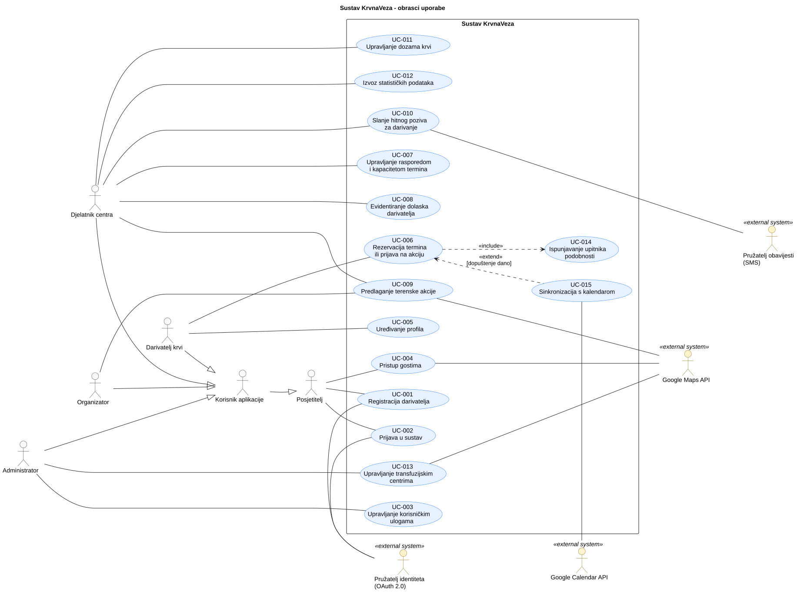

# 3. Obrasci uporabe

## 3.1 Dijagram obrazaca uporabe

**Slika 3.1. Dijagram obrazaca uporabe sustava KrvnaVeza**

**PlantUML izvor:** [izvor](./puml/3-1-krvnaveza-sustav-UC.puml)

## 3.2 Specifikacije obrazaca uporabe

**UC-001: Registracija darivatelja krvi.** 
| Element specifikacije | Opis |
| :--- | :--- |
| **Primarni akter** | Darivatelj krvi (A-01) |
| **Povezani zahtjevi** | F-001 |
| **Preduvjeti** | Nema. |
| **Glavni uspješni tok** | 1. korisnik odabire opciju prijave putem OAuth 2.0 poslužitelja   2. Sustav preusmjerava korisnika na vanjskog poslužitelja   3. Nakon uspješne prijave, sustav dohvaća token i prijavljuje korisnika |
| **Alternativni tokovi / Iznimke** | **1a - odustaje od prijave** Korisnik odustaje od prijave.  **2a - neuspjeh** Autentifikacija nije uspjela pa sustav šalje obavijest za mogućim ponovnim pokušajem prijave. |
| **Posljedice (ishod)** | Račun je uspješno kreiran i darivatelj krvi se može prijaviti u sustav. |

---

**UC-002: Prijava u sustav.** 
| Element specifikacije | Opis |
| :--- | :--- |
| **Primarni akter** | Darivatelj krvi (A-01), djelatnik centra (A-02), organizator (A-03), administrator (A-04) |
| **Povezani zahtjevi** | F-001 |
| **Preduvjeti** | Nema. |
| **Glavni uspješni tok** | 1. korisnik odabire opciju prijave putem OAuth 2.0 poslužitelja   2. Sustav preusmjerava korisnika na vanjskog poslužitelja   3. Nakon uspješne prijave, sustav dohvaća token i prijavljuje korisnika |
| **Alternativni tokovi / Iznimke** | **2a - odustaje od prijave** Korisnik odustaje od prijave.  **2b - neuspjeh** Autentifikacija nije uspjela pa sustav šalje obavijest za mogućim ponovnim pokušajem prijave.   **2c - uloga nema potrebne ovlasti** ne dopušta prijavu i šalje obavijest s razlogom. |
| **Posljedice (ishod)** | Uspješna prijava u aplikaciju. Grafičko sučelje ovisno o ulozi. |

---

**UC-003: Upravljanje korisničkim ulogama.** 
| Element specifikacije | Opis |
| :--- | :--- |
| **Primarni akter** | Administrator (A-04) |
| **Povezani zahtjevi** | F-020 ,F-021 |
| **Preduvjeti** | Administrator je prijavljen i ima ovlasti dodjeljivati uloge. |
| **Glavni uspješni tok** | 1. Otvara upravljanje korisnicima.   2. Odabire ulogu djelatnik centra ili organizator.    3. Sustav provjerava ovlasti   4. Sustav sprema novu ulogu |
| **Alternativni tokovi / Iznimke** | **2a - promjena nije odobrena** sustav ne sprema novu ulogu |
| **Posljedice (ishod)** | Promjena i dodavanje uloga djelatnicima i organizatorima. |

---

**UC-004: Pristup gostima.**
| Element specifikacije | Opis |
| :--- | :--- |
| **Primarni akter** | Posjetitelj (A-05) |
| **Povezani zahtjevi** | F-002, F-003 |
| **Preduvjeti** | Nema |
| **Glavni uspješni tok** | Posjetitelj odabire opciju "Nastavi kao gost" |
| **Alternativni tokovi / Iznimke** | Nema |
| **Posljedice (ishod)** | Pristup karti centara i akcija te pregled zaliha |

---

**UC-005: Uređivanje profila** 
| Element specifikacije | Opis |
| :--- | :--- |
| **Primarni akter** | Darivatelj krvi (A-01) |
| **Povezani zahtjevi** | F-004 |
| **Preduvjeti** | Darivatelj je prijavljen u sustav |
| **Glavni uspješni tok** | 1. Darivatelj pristupa svom profilu.   2. Unosi svoje podatke. |
| **Alternativni tokovi / Iznimke** | **2a - Krivi podaci** - darivatelj je unio krivo formatirane podatke |
| **Posljedice (ishod)** | Sustav ažurira osobne podatke darivatelja |

---

**UC-006: Rezervacija termina/Prijava na akciju**
| Element specifikacije | Opis |
| :--- | :--- |
| **Primarni akter** | Darivatelj krvi (A-01) |
| **Povezani zahtjevi** | F-005, F-006 |
| **Preduvjeti** | Darivatelj je prijavljen u sustav. Termin ima slobodnog mjesta/Akcija je aktualna. |
| **Glavni uspješni tok** | 1. Darivatelj pristupa rezervaciji.   2. Ispunjava kratki upitnik o podobnosti (UC-014).   3. Zadovoljen je kriterij podobnosti   4. Termin se dodaje u Google Kalendar te je generiran QR kod |
| **Alternativni tokovi / Iznimke** | **2a - Otkazivanje termina** Otkazivanje do 2 sata prije početka  |
| **Posljedice (ishod)** | Rezerviran termin i generiran QR kod. Ako je dano dopuštenje termin je dodan u kalendar. |

---

**UC-007: Upravljanje rasporedom i kapacitetom termina**
| Element specifikacije | Opis |
| :--- | :--- |
| **Primarni akter** | Djelatnik centra (A-02) |
| **Povezani zahtjevi** | F-007 |
| **Preduvjeti** | Djelatnik je prijavljen u sustav kao djelatnik i s odgovarajućim ovlastima dodijeljenim njegovoj ulozi. |
| **Glavni uspješni tok** | 1. djelatnik definira radno vrijeme i kapacitet termina   2. termini se prikazuju u sustavu |
| **Alternativni tokovi / Iznimke** |  |
| **Posljedice (ishod)** | Termini uspješno dodani. |

---

**UC-008: Evidentiranje dolaska darivatelja**
| Element specifikacije | Opis |
| :--- | :--- |
| **Primarni akter** | Djelatnik centra (A-02) |
| **Povezani zahtjevi** | F-008 |
| **Preduvjeti** | Djelatnik je prijavljen u sustav kao djelatnik i s odgovarajućim ovlastima dodijeljenim njegovoj ulozi. |
| **Glavni uspješni tok** | 1. djelatnik skenira QR kod   2. prijavljuje dolazak ili razlog odbijanja |
| **Alternativni tokovi / Iznimke** | **1a - Darivatelj se nije pojavio** Darivatelj se nije pojavio na terminu pa se automatski upisuje da nije došao.  |
| **Posljedice (ishod)** | Darivatelju je označen dolazak. |

---

**UC-009: Predlaganje terenske akcije**
| Element specifikacije | Opis |
| :--- | :--- |
| **Primarni akter** | Organizator (A-03) |
| **Povezani zahtjevi** | F-015, F-016 |
| **Preduvjeti** | Organizator je prijavljen u sustav kao organizator, što podrazumijeva neke dodatne ovlasti i dozvole za predlaganje akcija. |
| **Glavni uspješni tok** | 1. organizator predlaže akciju   2. za svaku akciju navodi lokaciju, datum, vrijeme i očekivani broj dolazaka   3. sustav sprema akciju u status predložene   4. Djelatnik transfuzijskog centra prihvaća akciju i dodjeljuje joj tim. |
| **Alternativni tokovi / Iznimke** | **4a - Djelatnik odbija** navodi razlog odbijanja. |
| **Posljedice (ishod)** | Terenska akcija darivanja je uspješno upisana u sustav (ili je uspješno odbijena uz obrazloženje). |

---

**UC-010: Slanje hitnog poziva za darivanje**
| Element specifikacije | Opis |
| :--- | :--- |
| **Primarni akter** | Djelatnik centra (A-02) |
| **Povezani zahtjevi** | F-014 |
| **Preduvjeti** | Zalihe određene krvne grupe pale su ispod kritične razine. Djelatnik je prijavljen sa odgovarajućim dozvolama. |
| **Glavni uspješni tok** | 1. zalihe određene krvne grupe pale su ispod kritične razine   2. djelatnik centra obaviješten je o kritičnoj zalihi   3. djelatniku je omogućeno da pošalje hitan poziv   4. Djelatnik odobrava slanje hitnog poziva   5. sustav putem SMS-a obaviještava podobne korisnike na tom području |
| **Alternativni tokovi / Iznimke** | **4a - Djelatnik odbija** navodi razlog odbijanja. |
| **Posljedice (ishod)** | Poslane obavijesti s poveznicom o slobodnim terminima. |

---

**UC-011: Upravljanje dozama krvi**
| Element specifikacije | Opis |
| :--- | :--- |
| **Primarni akter** | Djelatnik centra (A-02) |
| **Povezani zahtjevi** | F-011, F-012 |
| **Preduvjeti** | Djelatnik je prijavljen u sustav sa potrebnim dozvolama i ovlastima. |
| **Glavni uspješni tok** | 1. Djelatnik otvara pregled doza   2. Odabire dozu   3. Mijenja status doze   4. Sprema kada i tko je promijenio status doze   5. Sustav ponovno računa zalihe |
| **Alternativni tokovi / Iznimke** | **4a - Spremanje nije uspjelo** sustav javlja grešku, a stanje ostaje nepromijenjeno  |
| **Posljedice (ishod)** | Status doze je ažuriran i evidentiran, zalihe su preračunate |

---

**UC-012: Izvoz statističkih podataka**
| Element specifikacije | Opis |
| :--- | :--- |
| **Primarni akter** | Djelatnik centra (A-02) |
| **Povezani zahtjevi** | F-019 |
| **Preduvjeti** | Djelatnik je prijavljen u sustav sa potrebnim dozvolama i ovlastima. |
| **Glavni uspješni tok** | 1. djelatnik otvara stranicu "Statistika"   2. Sustav prikazuje kretanje zaliha po krvnim grupama   3. Djelatnik odabire izvoz u CSV   4. Sustav generira datoteku i omogućuje preuzimanje   |
| **Alternativni tokovi / Iznimke** | **2a - nema podataka** sustav ne nudi izvoz |
| **Posljedice (ishod)** | Djelatnik je preuzeo CSV datoteku sa statistikom zaliha|

---

**UC-013: Upravljanje transfuzijskim centrima**
| Element specifikacije | Opis |
| :--- | :--- |
| **Primarni akter** | Administrator (A-04) |
| **Povezani zahtjevi** | F-020 |
| **Preduvjeti** | Administrator je prijavljen u sustav sa svim dozvolama i ovlastima. |
| **Glavni uspješni tok** | 1. Administrator otvara popis transfuzijskih centara   2. Odabire dodavanje novog ili uređivanje postojećih   3. Unosi podatke   4. Sustav provjerava podatke pa ih sprema  |
| **Alternativni tokovi / Iznimke** | **4a - nevaljani podaci** sustav prikazuje poruku o grešci i ne sprema podatke |
| **Posljedice (ishod)** | Popis centara i njihov prikaz na karti su ažurirani. |

---

**UC-014: Ispunjavanje upitnika**
| Element specifikacije | Opis |
| :--- | :--- |
| **Primarni akter** | Darivatelj krvi (A-01) |
| **Povezani zahtjevi** | F-005, F-006, F-010 |
| **Preduvjeti** | Darivatelj je prijavljen u sustav. Započeo je rezervaciju termina ili prijavu na akciju (UC-006) |
| **Glavni uspješni tok** | 1. Sustav prikazuje upitnik.   2. Darivatelj odgovara na pitanja.   3. Sustav provjerava na temelju kriterija podobnosti   4. Sustav utvrđuje da je darivatelj podoban |
| **Alternativni tokovi / Iznimke** | **2a - Nedovršen upitnik** Ako korisnik ne odgovori na sva obavezna pitanja sustav ga upozori i ne dopušta nastavak rezervacije.  **4a - Nije podoban** Sustav ga upozorava, ne dopušta rezervaciju te mu javlja kada će opet biti podoban.  **4b - Odbijanje na pregledu** Sustav upozorava korisnika o mogućnosti da bude odbijen na pregledu |
| **Posljedice (ishod)** | Odobrena podobnost i može nastaviti s rezervacijom |

---

**UC-015: Sinkronizacija s kalendarom**
| Element specifikacije | Opis |
| :--- | :--- |
| **Primarni akter** | Darivatelj krvi (A-01) |
| **Povezani zahtjevi** | F-006 |
| **Preduvjeti** | Darivatelj je prijavljen u sustav. Rezervirao je termin. |
| **Glavni uspješni tok** | 1. Sustav šalje podatke Google Kalendaru   2. Google Kalendar stvara događaj.   3. Sustav šalje potvrdu kako je termin dodan u kalendar|
| **Alternativni tokovi / Iznimke** | **2a - Nedostaju dopuštenja** Korisnik nije dao dopuštenje za Google Kalendar. |
| **Posljedice (ishod)** | Termin je dodan u kalendar, a ako unos nije moguć, rezervacija termina ostaje valjana |

---

## 3.3 Provjera dosljednosti obrazaca uporabe

**Cilj:** Provjeriti međusobnu usklađenost obrazaca uporabe, aktera, zahtjeva i ispitnih slučajeva. Cjelovito mapiranje održava se isključivo u **[matrici sljedivosti zahtjeva](2-Analiza-zahtjeva.md#26-sljedivost-zahtjeva)**.

| Provjera | Pitanje za tim |
| --- | --- |
| Zahtjev | Je li svaki važan obrazac uporabe povezan s postojećim zahtjevom? |
| Akter | Odgovara li akter naveden ovdje prethodno utvrđenoj ulozi i dopuštenoj interakciji? |
| Aplikacija | Može li tim demonstrirati opisani glavni rezultat i važnu alternativu ili je opis jasno označen kao trenutačno oblikovanje? |

---

