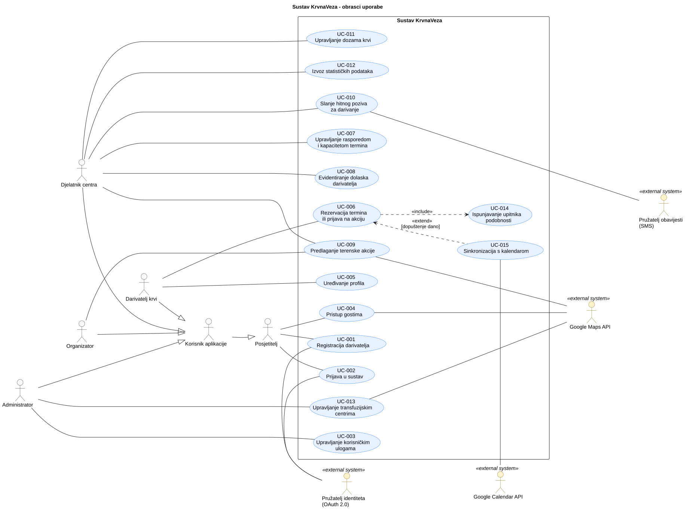
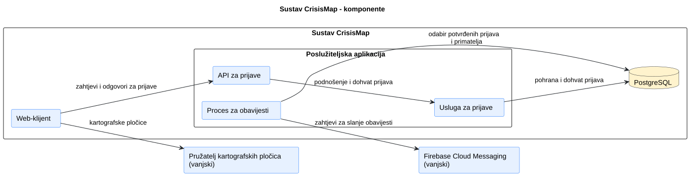
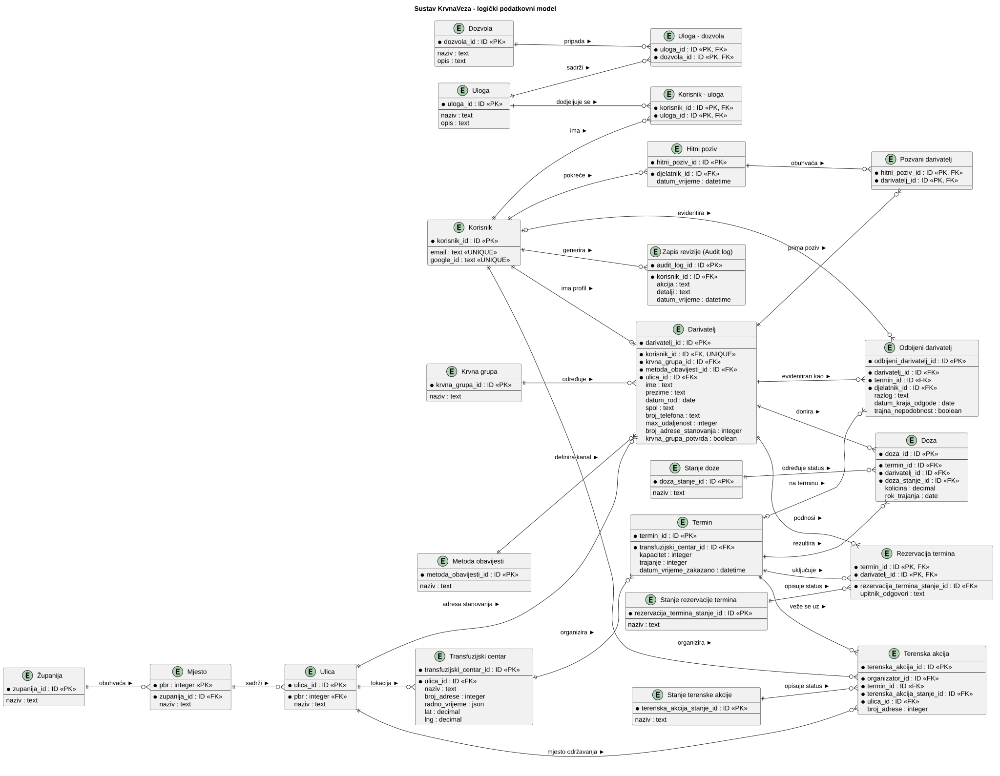
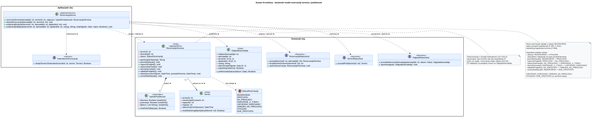
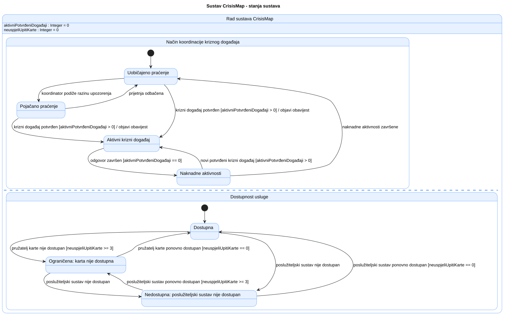

# KrvnaVeza — Projektna dokumentacija

**Kolegij:** [Programsko inženjerstvo](https://www.fer.unizg.hr/predmet/proinz), Fakultet elektrotehnike i računarstva Sveučilišta u Zagrebu  
**Akademska godina:** 2026./2027. 
**Tim:** Ekipa 
**Nastavnik:** Vlado Sruk  
**Asistent / demonstrator:** Saša Kendjel (asistent), Mirko Bušić (demonstrator)

## Pregled projekta


Aplikacija KrvnaVeza povezuje darivatelje krvi s transfuzijskim centrima i obližnjim akcijama darivanja. Lokacije i akcije prikazuju se na karti, a termin se može rezervirati putem aplikacije. Sustav obavještava darivatelje o akcijama i o tome kada ponovno smiju darivati, a djelatnicima centara omogućuje praćenje zaliha i slanje hitnih poziva kad su zalihe kritične.

**Aplikacija i osnovno postavljanje:** README repozitorija  
**Javno dostupna aplikacija:** pogledajte README – Postavljanje

## Članovi tima i uloge

Ažurirani popis članova, njihovih GitHub profila i glavnih uloga ili doprinosa nalazi se u README-u repozitoriju.

## Kazalo dokumentacije

| Stranica | Svrha |
| --- | --- |
| 1. Opseg projekta | Problem, cilj i granice projekta |
| 2. Analiza zahtjeva | Zahtjevi, ograničenja i sljedivost |
| 3. Obrasci uporabe | Akteri i reprezentativne interakcije korisnika |
| 4. Arhitektura i oblikovanje | Glavne odluke oblikovanja, struktura, podaci i ponašanje |
| 5. Ispitivanje | Pristup ispitivanju, stvarni rezultati i poznati nedostaci |
| 6. Postavljanje, instalacija i konfiguracija | Lokalna instalacija, konfiguracija, javno postavljanje i administracija |
| 7. Zaključak i budući rad | Zaključak i moguća daljnja poboljšanja |
| A. Pregled aktivnosti grupe | Aktivnosti tima, doprinosi i izazovi |

## Ključne točke projekta

| Kontrolna točka | Demonstracija | Video |
| --- | --- | --- |
| Iteracija 1 | [Poveznica na demonstraciju ili inačicu projekta] | [Poveznica na video Demo 1, ako je snimljen] |
| Završni pregled | [Poveznica na završnu inačicu projekta] | [Poveznica na video završne demonstracije, ako je snimljen] |

Dokumentacija se kontinuirano ažurira kako se aplikacija razvija.

## Organizacija projekta i razvojni proces

**Način rada:** Komunikaciju vodimo primarno preko WhatsApp-a za razrješavanje trenutnih problema ili dodatno pojašnjenje raspodjele posla. Sastanak vodimo na dvotjednoj bazi gdje detaljno razrađujemo sljedeće korake i nakon toga voditelj piše Issues koji su sukladni sa stavkama dogovorenim na sastanku.  


**Praćenje trenutačnih zadataka i nedostataka:** [Poveznica na GitHub Issues.](https://github.com/Domagoj-Boksic/KrvnaVeza-Ekipa/issues)


## Pravila dokumentacije

Dokumentacija se sastoji od međusobno povezanih Markdown stranica. Obavezni UML dijagrami izrađuju se u PlantUML-u, uz PlantUML izvor u dokumentaciji sačuvajte i čitljivu sliku. Primjeri u ovom predlošku kolegija pokazuju kako nešto dokumentirati; nisu dio rezultata studentskog projekta.

<details>
<summary><strong>Izvori dijagrama i nastavni primjeri</strong></summary>

Nastavni primjeri pretpostavljaju React/Vite klijentski dio, Node.js poslužiteljski dio, PostgreSQL, smještaj aplikacije na Renderu i Selenium WebDriver (JavaScript). Vaš tehnološki skup može biti drukčiji; u dokumentaciji opišite ono što stvarno koristite.

Za obrazac uporabe podnošenja prijave kriznog događaja u CrisisMapu tim može čuvati UML izvor u `.puml` datoteci, prikazati odgovarajuću sliku na relevantnoj stranici dokumentacije te ažurirati oboje kada se interakcija promijeni. Koristite stvarni dijagram i stvarno postavljanje vlastitog projekta. Domena ili tehnologija prikazana u primjeru ne postaje zahtjev osim ako je dio odobrenog zadatka.

>Napomena o primjerima: Blokovi „Primjer — CrisisMap" nastavni su scenarij, a ne rezultat ičijeg projekta; ne prepisujte ih. U primjerima se koriste React, Node.js, PostgreSQL, Render i Selenium samo radi dosljednosti. Vaš stog može biti drukčiji (npr. Java/Spring); dokumentirajte ono što stvarno koristite.</details>

## Akademski integritet, ponašanje i licenciranje

README repozitorija sadrži projektnu izjavu o uporabi umjetne inteligencije, informacije o kodeksu ponašanja i podršci te status licence ili ponovne uporabe. Pristupni podaci i druge tajne nikada se ne objavljuju u dokumentaciji niti dijele u običnim porukama.

## Izjava o uporabi umjetne inteligencije

<!-- UPUTA: Ovo je detaljan zapis uporabe umjetne inteligencije; README sadrži kratak sažetak i poveznicu na ovaj odjeljak. Unesite samo ono što se stvarno dogodilo i uklonite neupotrijebljene retke. Ako nije korišten nijedan alat generativne umjetne inteligencije, zamijenite cijeli odjeljak jednom rečenicom koja to jasno navodi. Svaki redak mora upućivati na stranicu, datoteku, zahtjev za uključivanje promjena (PR) ili zadatak. Nikada ne unosite pristupne podatke, osobne podatke ni tuđi zaštićeni sadržaj u alate umjetne inteligencije. -->

Kratak sažetak: README – Uporaba umjetne inteligencije. Ovaj odjeljak bilježi koji su alati korišteni, za koju dokumentaciju ili kod te kako je tim provjerio rezultat. Slijedi FER-ova [pravila o primjerenoj uporabi umjetne inteligencije](https://www.fer.unizg.hr/_download/repository/Policy%20on%20the%20appropriate%20use%20of%20artificial%20intelligence%20at%20the%20faculty%20of%20electrical%20engineering%20and%20computing%5B1%5D.pdf).

### Korišteni alati

| Alat | Inačica ili model | Koristio/la | Glavna svrha |
| --- | --- | --- | --- |
| Gemini | Gemini(web) | Ema Pavić | Provjera pravopisne točnosti dokumentacije |

### Opseg doprinosa umjetne inteligencije

| Stranica, datoteka ili artefakt | Vrsta pomoći | Što je alat proizveo | Što je tim zadao i promijenio | Lokacija |
| --- | --- | --- | --- | --- |
| [npr. 3. Obrasci uporabe, UC-002] | [Izrada nacrta / preoblikovanje / prijevod / izvor dijagrama / sažimanje] | [Kratak opis] | [Ulaz zadan alatu; dodane, ispravljene ili uklonjene činjenice] | [Stranica dokumentacije, `.puml` datoteka, PR] |

Stranice i artefakti koji nisu navedeni iznad izrađeni su bez pomoći generativne umjetne inteligencije. [Po želji: kao dodatne retke navedite kod ili ispitivanja izrađena uz pomoć umjetne inteligencije.]

### Provjera generiranog sadržaja

| Provjera | Kako je provedena | Dokaz |
| --- | --- | --- |
| Činjenična točnost | [Svaka tvrdnja o funkcionalnostima, ponašanju ili arhitekturi uspoređena je s pokrenutom aplikacijom i kodom] | [Imena pregledavatelja; poveznice na zahtjev za uključivanje promjena (PR) ili zadatak] |
| Nema tvrdnji o neostvarenim funkcionalnostima | [Provjereno je da opisane funkcionalnosti, ispitivanja i rezultati stvarno postoje; planirani rad označen je kao planiran] | [Usporedba s odjeljkom 5.4 (Ispitivanje) i odjeljkom 7.1 (Zaključak)] |
| Dosljednost s drugim stranicama | [Nazivi, ID-ovi i dijagrami provjereni su prema Analizi zahtjeva, Obrascima uporabe, Arhitekturi i oblikovanju te Ispitivanju] | [Kontrolni popis ili bilješka pregleda] |
| Izvori dijagrama | [Generirani PlantUML je iscrtan, ispravljen i odgovara implementiranom sustavu] | [`.puml` datoteka i izrađena slika] |
| Povjerljivi sadržaj | [Kako je tim osigurao da u upite ili dokumentaciju nisu unesene tajne, pristupni podaci ni osobni podaci] | [Primijenjeni postupak] |

### Pogreške pronađene u izlazu umjetne inteligencije

| Problem | Kako je pronađen | Rješenje |
| --- | --- | --- |
| [Netočna, izmišljena ili iz predloška preuzeta tvrdnja] | [Pregled, ispitivanje ili usporedba s aplikacijom] | [Ispravak s poveznicom] |

<!-- UPUTA: Zabilježite stvarne ispravke ili napišite „Nisu utvrđene”. Općenita tvrdnja poput „sav tekst je pregledan” nije dokaz; dokaz su prethodne tablice. Tim mora moći objasniti svaku rečenicu koju objavi. -->

<details>
<summary><strong>Primjer zapisa uporabe umjetne inteligencije</strong></summary>

**Primjer — CrisisMap:**

| Stranica ili artefakt | Vrsta pomoći | Što je alat proizveo | Što je tim zadao i promijenio | Lokacija |
| --- | --- | --- | --- | --- |
| 3. Obrasci uporabe, UC-002 | Izrada nacrta | Prvu inačicu glavnog i alternativnih tijekova | Tim je zadao stvarna polja obrasca i uklonio granu prijave u sustav koja u aplikaciji ne postoji | Primjer PR #31 |
| Sekvencijski dijagram, podnošenje prijave | Izvor dijagrama | Nacrt PlantUML-a | Tim je uskladio nazive sudionika s komponentama i uklonio korak slanja obavijesti koji nije implementiran | `diagrams/report-submission.puml` (primjer) |

| Problem | Kako je pronađen | Rješenje |
| --- | --- | --- |
| U tekstu je stajalo da se obavijesti dostavljaju unutar jedne minute | Usporedba s Ispitivanjem (5.4): dostava nikada nije ispitana | Tvrdnja je uklonjena; obavijesti su navedene pod Budućim radom |
| Nacrt je kopirao primjer zahtjeva F-005 iz predloška kao projektni zahtjev | Usporedba s vlastitim popisom zahtjeva tima | Zamijenjeno stvarnim zahtjevom tima |

**Analiza primjera:** Svaki redak navodi stranicu ili datoteku, ono što je alat generirao i ono što je tim promijenio. Pogreške su tipične za generiranu dokumentaciju: funkcionalnost koja ne postoji i tekst predloška prikazan kao činjenica o projektu. Tvrdnje poput „AI je korišten svugdje” ili „sav tekst je pregledan” nije moguće provjeriti. Ovo je nastavni scenarij, a ne opis objavljenog projekta.

</details>


<div style="page-break-after: always;"></div>

# 1. Opseg projekta

## 1.1 Problem i cilj projekta

Bolnice svakodnevno trebaju krv za operacije, liječenje onkoloških bolesnika i zbrinjavanje hitnih stanja. Krv se ne može proizvesti, a njezini sastojci imaju ograničen rok trajanja, pa zalihe moraju stalno obnavljati dobrovoljni darivatelji.
Zalihe pritom nisu stabilne: ljeti i u vrijeme blagdana darivatelja je manje, a zaliha pojedinih krvnih grupa, osobito negativnih, zna pasti ispod kritične razine.
Mnogi bi darivatelji češće darivali krv kad bi znali kada ponovno smiju darivati, gdje se i kada održava najbliža akcija darivanja i da je upravo njihova krvna grupa trenutno potrebna. 
Postojeći sustavi oslanjaju se na zastarjele metode obavještavanja darivatelja (telefonski pozivi, plakati i poruke) koje ne dopiru do svih, dok se evidencija darivanja vodi odvojeno od informacija koje su darivateljima dostupne.
Cilj je stvoriti funkcionalnu platformu koja povezuje darivatelje krvi, transfuzijske centre i organizatore terenskih akcija darivanja. 
Darivatelj na njoj vidi kada i gdje može darivati i rezervira termin, centar prati zalihe i u slučaju potrebe ciljano poziva odgovarajuće darivatelje, a organizator akcija lakše planira akcije i prati odaziv.

## 1.2 Ciljani korisnici i dionici

| Skupina korisnika ili dionika | Potreba ili interes relevantan za ovaj projekt |
| --- | --- |
| Građanin  | Pregled lokacija i slobodnih termina, rezervacija termina, primanje obavijesti i podsjetnika te pregled povijesti darivanja|
| Djelatnik | Kapacitet termina, radno vrijeme, potvrđivanje krvne grupe, unos i promjena zaliha, odobravanje hitnog poziva i određuje područje na koje se šalje, prihvaća ili odbija sudjelovanje na nekoj od akcija.  |
| Organizator akcija | Predlaganje terenskih akcija, za svaku akciju određuje vrijeme, lokaciju, datum i očekivani broj darivatelja, dodjela priznanja, |
| Administrator | Upravljanje korisnicima, dodjelivanje uloga, podešavaju parametre pravila podobnosti i pragove zaliha, pregled statistike korištenja sustava |

## 1.3 Granice projekta

**Uključeno:**
- web aplikacija prilagođena mobilnim uređajima (responsive)
- registracija i prijava korisnika putem Google OAuth 2.0 protokola s tokenima te upravljanje korisničkim ulogama
- javni prikaz karte transfuzijskih centara, najavljenih akcija i stanja zaliha
- upravljanje profilom darivatelja i automatski izračun datuma od kojeg ponovno smije darivati
- rezervacija termina i prijava na terenske akcije uz upitnik za samoprocjenu podobnosti, QR kod za potvrdu termina i sinkronizacija s Google Kalendarom
- evidentiranje dolazaka skeniranjem QR koda, upravljanje terminima, dozama i zalihama krvi;
- obavijesti darivateljima i hitni pozivi za darivanje pri padu zaliha ispod kritične razine;
- prijedlog i odobravanje terenskih akcija te pregled statistike
- pregled povijesti darivanja, PDF potvrda o darivanju i značke za jubilarna darivanja
- statistika zaliha s izvozom u CSV te administracija centara, korisnika i parametara sustava

**Izvan opsega ili odgođeno:** 
- integracija s bolničkim informacijskim sustavima
- stvarno medicinsko testiranje i potvrda zdravstvenog stanja darivatelja (sustav samo evidentira statuse)

Navedeno je izostavljeno jer nije dio odobrenog zadatka i nadilazi vremenski okvir projekta.

**Vanjske ovisnosti:** 
- Google OAuth 2.0 (autorizacija korisnika putem tokena)
- Google Maps API (prikaz karte i lokacija)
- Google Calendar API (sinkronizacija termina s kalendarom darivatelja)
- vanjski servis za slanje SMS poruka (npr. Infobip ili Twilio)

## 1.4 Postojeći pristupi i opravdanost projekta

Krv trenutno građani mogu donirati u transfuzijski centrima i organiziranim akcijama, no sve te informacije su raštrkane po internetu, plakatima i panoima. U Hrvatskoj samo 4-5 % osoba daruje krv ("https://hztm.hr/2025/01/22/vodic-za-darivanje-krvi/"). Ovaj projekt bi mogao povećati te brojke spajajući sve informacije na jedno mjesto i aktivnim obavještavanjem darivatelja o akcijama i potrebama popunjavanja zaliha.

---


<div style="page-break-after: always;"></div>

# 2. Analiza zahtjeva

U ovom poglavlju opisani su funkcijski i nefunkcijski zahtjevi sustava KrvnaVeza, njegovi dionici i akteri, ograničenja i pretpostavke te povezanost zahtjeva s obrascima uporabe. Zahtjevi su definirani na temelju projektnog zadatka i predstavljaju osnovu za projektiranje, implementaciju i ispitivanje sustava.

## 2.1 Funkcijski zahtjevi

| ID | Opis | Prioritet | Izvor | Kriteriji prihvaćanja |
| --- | --- | --- | --- | --- |
| F-001 | Sustav omogućuje korisnicima registraciju i prijavu putem Google OAuth 2.0 protokola koristeći tokene. | Visok | Projektni zadatak | Korisnik se može registrirati putem Google računa, bit će preusmjeren na odgovarajući profil, a kasnije se može prijaviti bez ponovne registracije. |
| F-002 | Sustav omogućuje prikaz karte i lokacije transfuzijskih centara, najavljenih akcija darivanja za neregistrirane i registrirane korisnike. | Visok | Projektni zadatak | Korisnik ima pregled karte i lokacija neovisno o registraciji. |
| F-003 | Sustav omogućuje prikaz zaliha za neregistrirane i registrirane korisnike. | Visok | Projektni zadatak | Korisnik ima pregled zaliha neovisno o registraciji. |
| F-004 | Sustav omogućuje korisniku darivatelju unos svojih osobnih podataka. Sustav krvnu grupu označuje kao neprovjerenu | Visok | Projektni zadatak | Korisnik darivatelj može nakon registracije ispuniti svoje podatke i oznaka neprovjeren se uklanja kada djelatnik potvrdi. |
| F-005 | Sustav za svakog darivatelja izračunava datum od kojeg ponovno smije darivati. | Visok | Projektni zadatak | Darivatelju su ponuđeni datumi darivanja ovisno o izračunu kada može darivati. |
| F-006 | Sustav omogućuje darivatelju rezervaciju termina u centru ili prijavu na terensku akciju uz ispunjavanje upitnika | Visok | Projektni zadatak | Darivatelj ovisno o podobnosti može rezervirati termin. Upisuje se u GoogleCalendar darivatelja i generira se QR kod. Otkazivanje je moguće do dva sata prije početka. |
| F-007 | Sustav omogućuje djelatniku definiranje radnog vremena i kapaciteta termina te upravljanje tokom termina. | Visok | Projektni zadatak | Djelatnik transfuzijskog centra ima pristup i može unositi i definirati radno vrijeme i kapacitet. Upravlja tokom termina kako pregled napreduje |
| F-008 | Sustav omogućuje djelatniku evidentiranje dolazaka skeniranjem QR koda. | Visok | Projektni zadatak | Djelatniku radi skeniranje QR koda, a darivatelju je generiran QR kod. Djelatnik transfuzijskog centra unosi evidenciju dolaznosti i razlog zašto je potencijalni darivatelj odbijen. |
| F-009 | Sustav šalje obavijest s popisom termina i akcija darivatelju kad postane ponovno podoban | Visok | Projektni zadatak | Nakon prolaska izračunatog vremena nepodobnosti sustav obavještava darivatelja da može ponovno darivati krv. Prosljeđuje mu popis akcija i termina u njegovoj blizini. |
| F-010 | Sustav darivatelja prebacuje na kratki upitnik prije same rezervacije nakon kojeg ga upozorava ako vjerojatno neće moći darivati | Visok | Projektni zadatak | Prije same rezervacije termina darivatelju je priložen kratki upitnik. Njegovim odgovorima sustav određuje vjerojatnost odbijanja darivanja na pregledu i upozorava darivatelja. |
| F-011 | Sustav omogućuje djelatniku upravljanje prikupljenim dozama. | Visok | Projektni zadatak | Djelatnik regulira stanje doze kroz proces pregleda i testiranja. |
| F-012 | Sustav računa zalihe iz prikupljenih i odobrenih doza. | Visok | Projektni zadatak | Sustav ažurira stanje zaliha računanjem aktualnih doza. |
| F-013 | Sustav omogućuje darivatelju pregled povijesti njegovog darivanja. | Srednji | Projektni zadatak | Svako darivanje je evidentirano i sačuvano kako bi korisnici mogli pregledati svoju povijest darivanja. |
| F-014 | Nakon pada zaliha ispod kritične razine sustav predlaže djelatniku hitni poziv na darivanje te pregledava statistiku darivanja nakon. | Visok | Projektni zadatak | Kad zalihe padnu u kritično područje sustav predlaže hitni poziv na koji se djelatnici mogu odazvati. Nakon darivanja hitnog poziva sustav pregleda statistiku. |
| F-015 | Sustav omogućuje organizatoru akcija predlaganje akcija te unos podataka o akciji (lokacija, vrijeme, datum...) i pregled statistike. | Visok | Projektni zadatak | Organizator ima mogućnost prijedloga akcije darivanja. Unosi podatke o akciji kako bi korisnici znali gdje je i kada. Nakon akcije ima pristup statistici darivanja. |
| F-016 | Sustav djelatniku omogućuje prihvaćanje predložene akcije i slanje mobilnog tima te odbijanje akcije uz obrazloženje. | Visok | Projektni zadatak | Nakon što organizator predloži akciju djelatnici imaju mogućnost prihvaćanja i odbijanja. Ako prihvate šalju mobilni tim, ako odbiju prilažu objašnjenje zašto odbijaju. |
| F-017 | Sustav dodjeluje darivatelju značke nakon jubilarnih darivanja. | Nizak | Projektni zadatak | Nakon određenih jubilarnih darivanja sustav dodjeluje značke profilu darivatelja. |
| F-018 | Sustav omogućuje darivatelju preuzimanje potvrde darivanja u PDF formatu. | Srednji | Projektni zadatak | Nakon odrađenog uspješnog darivanja darivatelj ima pristup potvrdi darivanja u PDF formatu. |
| F-019 | Sustav omogućuje djelatniku pregled podataka o zalihama te mogućnost izvoza podataka u CSV formatu | Srednji | Projektni zadatak | Djelatnik ima pristup stranici "Statistika" gdje može vidjeti kretanje zaliha po krvnim grupama u vremenu, prosječnu dnevnu potrošnju, procjenu dana do nestašice. Također može navedeno izvesti u CSV formatu. |
| F-020 | Sustav omogućuje adminu održavanje platforme | Visok | Projektni zadatak | Admin može upravljati korisnicima i transfuzijskim centrima, podešava parametre pravila podobnosti i pragove zaliha te pregled statistike korištenja sustava te deaktivirati korisnički račun |
| F-021 | Sustav mora omogućiti administratoru dodjeljivanje i promjenu korisničkih uloga. Te promjene se moraju evidentirati u sustavu. | Visok | Projektni zadatak | Provjeriti dodjeljuju li se i pamte uloge korisnika prijavljenih u sustav. |

## 2.2 Nefunkcijski zahtjevi

| ID | Opis | Prioritet | Izvor | Način provjere |
| --- | --- | --- | --- | --- |
| NF-01 | Kompatibilnost s mobitelima | Visok | Projektni zadatak | Testirati aplikaciju pri širini od 360px u različitim web-preglednicima. |
| NF-02 | Sigurnost korisničkih podataka  | Visok | Projektni zadatak | Provjeriti pristup s drugih računa tj. neovlaštenim korisnicima te pregledati zapisnik pristupa. |
| NF-03 | Zakonska usklađenost (GDPR) - podaci obrisanih korisnika moraju biti trajno anonimizirani | Visok | Projektni zadatak | Pokrenuti zahtjev brisanja računa te uz izravan pristup bazi provjeriti jesu li podaci (npr. ime, prezime) anonimizirani |
| NF-04 | Performanse ( vrijeme odziva ) - bez ručnog osvježavanja zaliha | Visok | Projektni zadatak | Promjena vidljiva svim korisnicima unutar 5 sekundi bez osvježavanja. |
| NF-05| Sigurnost ( Autorizacija ) - uloge | Visok | Projektni zadatak | Testiranje slanjem direktnih API zahtjeva i npr. testiranje može li uloga korisnik uređivati zaliha ili će izbaciti grešku |
| NF-06 | Pouzdanost i otpornost na greške - obavijestiti korisnika o nedostupnosti vanjske usluge ili prekidu veze | Srednji | Projektna pretpostavka | Simuliranje takvih nedostupnosti vanjskih usluga i provjera ponašanja sustava. |
| NF-07 | Integritet i sljedivost podataka doza krvi - imaju svoj id i status | Visok | Projektni zadatak| Analizirati zapise u bazi podataka, provjeriti kronološki slijed svih doza i njihovih statusa. |
| NF-08 | Sigurnost ( Autentifikacija ) - Aplikacija mora koristiti sigurnosni protokol OAuth 2.0 za zaštitu korisničkih podataka. (A-01 do A-04) | Visok | Projektni zadatak | Provjera mogućnosti prijave i redirect na Google sučelje za prijavu. |
| NF-09 | Dostupnost - kritične funkcije (hitni pozivi, zalihe i podaci darivatelja) dostupni tijekom demonstracije i testnog razdoblja | Visok | Projektna pretpostavka | Pratiti dopstupnost kritičnih funkcija tijekom testnog razdoblja putem dostupnih alata na webu |
| NF-10 | Upotrebljivost - jezik sučelja hrvatski | Srednji | Projektna pretpostavka | Pregled korisničkog sučelja |
| NF-11 | Intuitivnost - jednostavno korištenje web-aplikacije (jasni nazivi, opis dostupnih funkcionalnosti, upute za korištenje web-aplikacije s navedenim koracima korištenja) | Srednji | Projektna pretpostavla | Testiranje s pet osoba koje ne poznaju sustav: svaka mora samostalno bez pomoći prijaviti se u sustav i izvršiti rezervaciju na jedan od ponuđenih termina |


## 2.3 Dionici i akteri


| ID uloge ili aktera | Odnos prema sustavu | Relevantni zahtjevi |
| --- | --- | --- |
| A-01 | Darivatelj krvi | F-001, F-004, NF-03, F-005, F-006, F-010, F-013, F-018: Uređuje profil, provjerava podobnost, rezervira termine, pregled povijesti, preuzimanje potvrde i ispunjava upitnik. |
| A-02 | Djelatnik centra | F-007, F-008, F-011, F-012, F-014, F-016, F-019: Upravlja terminima, evidentira dolaske, doze i zalihe te odobrava hitne obavijesti. | 
| A-03 | Organizator | F-015: Predlaže akcije, prati prijave, prati aktivnosti.  |
| A-04 | Administrator | F-020, F-021: Upravlja korisnicima, centrima, korisničkim ulogama, pravilima podobnosti i granicama zaliha. |
| A-05 | Posjetitelji | F-002, F-003: Bez prijave pregledava karte, najavljene akcije i zalihe krvi. |


---

## 2.4 Ograničenja i pretpostavke

| ID | Tip | Opis ograničenja ili pretpostavke | Izvor | Inženjerska posljedica / Provjera |
| --- | --- | --- | --- | --- |
| C-01 | Ograničenje | Projektni zadatak zahtijeva autorizaciju preko OAuth 2.0 protokola koristeći tokene | Projektni zadatak | Odraditi autorizaciju preko zadanog protokola |
| C-02 | Ograničenje | Obrada i unos osjetljivih zdravstvenih podataka darivatelja. | Zakonski propisi | Pristup podacima strogo kontroliran preko uloga i dozvola. |
| AS-01 | Pretpostavka | Korisnici imaju pristup internetu. | Procjena tima  | Planirati pristup značajkama bez interneta. |
| AS-02 | Pretpostavka | Korisnici koji dopuste sinkronizaciju s kalendarom imaju važeći Google račun.| Procjena tima | U slučaju da korisnik dopusti sinkronizaciju s kalendarom, a nema Google račun rezervacija termina će se uspješno izvršiti, ali će se preskočiti dio unosa u kalendar. |


---

## 2.5 Značajne promjene zahtjeva

| Datum | ID zahtjeva | Promjena i razlog | Dogovoreno s / dokaz |
| --- | --- | --- | --- |
|  |  |  |  |


## 2.6 Sljedivost zahtjeva

**Cilj:** Osigurati dvosmjernu sljedivost — povezati zahtjeve s opisanim ponašanjem, dijelovima sustava koji ih ostvaruju te ispitivanjem ili drugom provjerom. 

| ID zahtjeva | Obrazac uporabe / modul | Arhitekturna realizacija | Ispitivanje ili provjera |
| --- | --- | --- | --- |
| F-001 | UC-001: Registracija darivatelja krvi, UC-002:Prijava u sustav.| OAuth2.0,modul baze podataka za korisnika. | ST-01 Valjano podnošenje prijave; ST-02 Odbijanje nevaljanog tokena |
| F-002 | UC-004: Pristup gostima | Web sučelje, Google Maps API | ST-03 Prikaz karte i centara neregistriranim korisnicima |
| F-003 | UC-004: Pristup gostima | Modul zaliha, web sučelje | ST-04 Pregled zaliha za određenu krvnu grupu neregistriranim korisnicima |
| F-004 | UC-005: Uređivanje profila | Web sučelje, modul baze podataka | ST-05 Unos podataka i označavanje podataka kao neprovjerenim |
| F-005 | UC-006: Rezervacija termina/Prijava na akciju | Izračun podobnosti | ST-06 Provjera izračuna datuma |
| F-006 |UC-006: Rezervacija termina/Prijava na akciju ; UC-015: Sinkronizacija s kalendarom | Prijava na termine i akcije | ST-07 Rezervacija termina, generiranje QR koda i upis u kalendar|
| F-007 | UC-007: Upravljanje rasporedom i kapacitetom termina | definiranje radnog vremena i kapaciteta | ST-08 Unos i izmjena termina od strane djelatnika |
| F-008 | UC-008: Evidentiranje dolaska darivatelja | QR kod servis | ST-09 Skeniranje QR koda i obilježen dolazak ili razlog zašto je odbijen |
| F-009 | Pozadinski proces | Sustav obavijesti | ST-10 Provjera slanja obavijesti |
| F-010 | UC-014: Ispunjavanje upitnika| Popunjavanje podataka za izračun podobnosti | ST-11 Procjena rizika od odbijanja na terminu na temelju upitnika |
| F-011 | UC-011: Upravljanje dozama krvi | Modul za upravljanje dozama | ST-12 Ažuriranje statusa doza  |
| F-012 | UC-011: Upravljanje dozama krvi | Baza podataka  | ST-13 Automatski izračun zaliha na temelju odobrenih doza |
| F-013 | Na čekanju - UC još nije definiran | Baza podataka (darivatelj)| ST-14 Pristup prijavljenim korisnicima svojoj povijesti darivanja |
| F-014 | UC-010: Slanje hitnog poziva za darivanje | Pozadinski nadzor zaliha | ST-15 Automatska detekcija pada zaliha ispod kritične razine i slanje hitnog poziva |
| F-015 | UC-009: Predlaganje terenske akcije | Sučelje organizatora | ST-16 Organizator predlaže akciju s lokacijom i vremenom |
| F-016 | UC-009: Predlaganje terenske akcije | Sučelje djelatnika | ST-17 Prihvaćanje ili odbijanje akcije |
| F-017 | Sustav nagrađivanja | Modul znački | ST-18 Dodavanje jubilarnih znački |
| F-018 | Na čekanju - UC još nije definiran | Izvoz u PDF | ST-19 Generiranje valjane potvrde o darivanju|
| F-019 | UC-012: Izvoz statističkih podataka | Statistika, izvoz u CSV| ST-20 Izvoz statističkih podataka u CSV formatu |
| F-020 | UC-013: Upravljanje transfuzijskim centrima | Role-Based Access Control | ST-21 Upravljanje centrima i parametrima sustava |
| F-021 | UC-003: Upravljanje korisničkim ulogama | Korisničke uloge i audit log| ST-22 Promjena uloga i evidentiranje te iste promjene|

---

## 2.7 Pregled zahtjeva

**Cilj:** Zabilježiti važne povratne informacije o zahtjevima i odluke koje iz njih proizlaze na dvije formalne kontrolne točke projekta, u 7. i 14. tjednu.

| Kontrolna točka | Povratna informacija ili nalaz | Odluka o zahtjevu ili opsegu |
| --- | --- | --- |
| Iteracija 1 | [Povratna informacija] | [Odluka; vidi odjeljak 2.5] |
| Demo 2  | [Povratna informacija] | [Odluka; vidi odjeljak 2.5] |
| Završni pregled | [Povratna informacija] | [Odluka; vidi odjeljak 2.5] |

---


<div style="page-break-after: always;"></div>

# 3. Obrasci uporabe

## 3.1 Dijagram obrazaca uporabe


**Slika 3.1. Dijagram obrazaca uporabe sustava KrvnaVeza**


**PlantUML izvor:** [izvor](./puml/3-1-krvnaveza-sustav-UC.puml)


## 3.2 Specifikacije obrazaca uporabe

**UC-001: Registracija darivatelja krvi.** 
| Element specifikacije | Opis |
| :--- | :--- |
| **Primarni akter** | Darivatelj krvi (A-01) |
| **Povezani zahtjevi** | F-001 |
| **Preduvjeti** | Nema. |
| **Glavni uspješni tok** | 1. korisnik odabire opciju prijave putem OAuth 2.0 poslužitelja <br> 2. Sustav preusmjerava korisnika na vanjskog poslužitelja <br> 3. Nakon uspješne prijave, sustav dohvaća token i prijavljuje korisnika |
| **Alternativni tokovi / Iznimke** | **1a - odustaje od prijave** Korisnik odustaje od prijave. <br>**2a - neuspjeh** Autentifikacija nije uspjela pa sustav šalje obavijest za mogućim ponovnim pokušajem prijave. |
| **Posljedice (ishod)** | Račun je uspješno kreiran i darivatelj krvi se može prijaviti u sustav. |


---


**UC-002: Prijava u sustav.** 
| Element specifikacije | Opis |
| :--- | :--- |
| **Primarni akter** | Darivatelj krvi (A-01), djelatnik centra (A-02), organizator (A-03), administrator (A-04) |
| **Povezani zahtjevi** | F-001 |
| **Preduvjeti** | Nema. |
| **Glavni uspješni tok** | 1. korisnik odabire opciju prijave putem OAuth 2.0 poslužitelja <br> 2. Sustav preusmjerava korisnika na vanjskog poslužitelja <br> 3. Nakon uspješne prijave, sustav dohvaća token i prijavljuje korisnika |
| **Alternativni tokovi / Iznimke** | **2a - odustaje od prijave** Korisnik odustaje od prijave. <br>**2b - neuspjeh** Autentifikacija nije uspjela pa sustav šalje obavijest za mogućim ponovnim pokušajem prijave. <br> **2c - uloga nema potrebne ovlasti** ne dopušta prijavu i šalje obavijest s razlogom. |
| **Posljedice (ishod)** | Uspješna prijava u aplikaciju. Grafičko sučelje ovisno o ulozi. |


---


**UC-003: Upravljanje korisničkim ulogama.** 
| Element specifikacije | Opis |
| :--- | :--- |
| **Primarni akter** | Administrator (A-04) |
| **Povezani zahtjevi** | F-020 ,F-021 |
| **Preduvjeti** | Administrator je prijavljen i ima ovlasti dodjeljivati uloge. |
| **Glavni uspješni tok** | 1. Otvara upravljanje korisnicima. <br> 2. Odabire ulogu djelatnik centra ili organizator. <br>  3. Sustav provjerava ovlasti <br> 4. Sustav sprema novu ulogu |
| **Alternativni tokovi / Iznimke** | **2a - promjena nije odobrena** sustav ne sprema novu ulogu |
| **Posljedice (ishod)** | Promjena i dodavanje uloga djelatnicima i organizatorima. |


---


**UC-004: Pristup gostima.**
| Element specifikacije | Opis |
| :--- | :--- |
| **Primarni akter** | Posjetitelj (A-05) |
| **Povezani zahtjevi** | F-002, F-003 |
| **Preduvjeti** | Nema |
| **Glavni uspješni tok** | Posjetitelj odabire opciju "Nastavi kao gost" |
| **Alternativni tokovi / Iznimke** | Nema |
| **Posljedice (ishod)** | Pristup karti centara i akcija te pregled zaliha |


---


**UC-005: Uređivanje profila** 
| Element specifikacije | Opis |
| :--- | :--- |
| **Primarni akter** | Darivatelj krvi (A-01) |
| **Povezani zahtjevi** | F-004 |
| **Preduvjeti** | Darivatelj je prijavljen u sustav |
| **Glavni uspješni tok** | 1. Darivatelj pristupa svom profilu. <br> 2. Unosi svoje podatke. |
| **Alternativni tokovi / Iznimke** | **2a - Krivi podaci** - darivatelj je unio krivo formatirane podatke |
| **Posljedice (ishod)** | Sustav ažurira osobne podatke darivatelja |


---


**UC-006: Rezervacija termina/Prijava na akciju**
| Element specifikacije | Opis |
| :--- | :--- |
| **Primarni akter** | Darivatelj krvi (A-01) |
| **Povezani zahtjevi** | F-005, F-006, F-010 |
| **Preduvjeti** | Darivatelj je prijavljen u sustav. Termin ima slobodnog mjesta/Akcija je aktualna. |
| **Glavni uspješni tok** | 1. Darivatelj pristupa rezervaciji. <br> 2. Ispunjava kratki upitnik o podobnosti (UC-014). <br> 3. Zadovoljen je kriterij podobnosti <br> 4. Termin se dodaje u Google Kalendar te je generiran QR kod |
| **Alternativni tokovi / Iznimke** | **2a - Otkazivanje termina** Otkazivanje do 2 sata prije početka  |
| **Posljedice (ishod)** | Rezerviran termin i generiran QR kod. Ako je dano dopuštenje termin je dodan u kalendar. |


---


**UC-007: Upravljanje rasporedom i kapacitetom termina**
| Element specifikacije | Opis |
| :--- | :--- |
| **Primarni akter** | Djelatnik centra (A-02) |
| **Povezani zahtjevi** | F-007 |
| **Preduvjeti** | Djelatnik je prijavljen u sustav kao djelatnik i s odgovarajućim ovlastima dodijeljenim njegovoj ulozi. |
| **Glavni uspješni tok** | 1. djelatnik definira radno vrijeme i kapacitet termina <br> 2. termini se prikazuju u sustavu |
| **Alternativni tokovi / Iznimke** |  |
| **Posljedice (ishod)** | Termini uspješno dodani. |


---


**UC-008: Evidentiranje dolaska darivatelja**
| Element specifikacije | Opis |
| :--- | :--- |
| **Primarni akter** | Djelatnik centra (A-02) |
| **Povezani zahtjevi** | F-008 |
| **Preduvjeti** | Djelatnik je prijavljen u sustav kao djelatnik i s odgovarajućim ovlastima dodijeljenim njegovoj ulozi. |
| **Glavni uspješni tok** | 1. djelatnik skenira QR kod <br> 2. prijavljuje dolazak ili razlog odbijanja |
| **Alternativni tokovi / Iznimke** | **1a - Darivatelj se nije pojavio** Darivatelj se nije pojavio na terminu pa se automatski upisuje da nije došao.  |
| **Posljedice (ishod)** | Darivatelju je označen dolazak. |


---


**UC-009: Predlaganje terenske akcije**
| Element specifikacije | Opis |
| :--- | :--- |
| **Primarni akter** | Organizator (A-03) |
| **Povezani zahtjevi** | F-002, F-006, F-015, F-016, F-021 |
| **Preduvjeti** | Organizator je prijavljen u sustav kao organizator, što podrazumijeva neke dodatne ovlasti i dozvole za predlaganje akcija. |
| **Glavni uspješni tok** | 1. organizator predlaže akciju <br> 2. za svaku akciju navodi lokaciju, datum, vrijeme i očekivani broj dolazaka <br> 3. sustav sprema akciju u status predložene <br> 4. Djelatnik transfuzijskog centra prihvaća akciju i dodjeljuje joj tim. |
| **Alternativni tokovi / Iznimke** | **4a - Djelatnik odbija** navodi razlog odbijanja. |
| **Posljedice (ishod)** | Terenska akcija darivanja je uspješno upisana u sustav (ili je uspješno odbijena uz obrazloženje). |


---


**UC-010: Slanje hitnog poziva za darivanje**
| Element specifikacije | Opis |
| :--- | :--- |
| **Primarni akter** | Djelatnik centra (A-02) |
| **Povezani zahtjevi** | F-005, F-012, F-014, F-020 |
| **Preduvjeti** | Zalihe određene krvne grupe pale su ispod kritične razine. Djelatnik je prijavljen sa odgovarajućim dozvolama. |
| **Glavni uspješni tok** | 1. zalihe određene krvne grupe pale su ispod kritične razine <br> 2. djelatnik centra obaviješten je o kritičnoj zalihi <br> 3. djelatniku je omogućeno da pošalje hitan poziv <br> 4. Djelatnik odobrava slanje hitnog poziva <br> 5. sustav putem SMS-a obaviještava podobne korisnike na tom području |
| **Alternativni tokovi / Iznimke** | **4a - Djelatnik odbija** navodi razlog odbijanja. |
| **Posljedice (ishod)** | Poslane obavijesti s poveznicom o slobodnim terminima. |


---


**UC-011: Upravljanje dozama krvi**
| Element specifikacije | Opis |
| :--- | :--- |
| **Primarni akter** | Djelatnik centra (A-02) |
| **Povezani zahtjevi** | F-011, F-012 |
| **Preduvjeti** | Djelatnik je prijavljen u sustav sa potrebnim dozvolama i ovlastima. |
| **Glavni uspješni tok** | 1. Djelatnik otvara pregled doza <br> 2. Odabire dozu <br> 3. Mijenja status doze <br> 4. Sprema kada i tko je promijenio status doze <br> 5. Sustav ponovno računa zalihe |
| **Alternativni tokovi / Iznimke** | **4a - Spremanje nije uspjelo** sustav javlja grešku, a stanje ostaje nepromijenjeno  |
| **Posljedice (ishod)** | Status doze je ažuriran i evidentiran, zalihe su preračunate |


---


**UC-012: Izvoz statističkih podataka**
| Element specifikacije | Opis |
| :--- | :--- |
| **Primarni akter** | Djelatnik centra (A-02) |
| **Povezani zahtjevi** | F-012, F-019 |
| **Preduvjeti** | Djelatnik je prijavljen u sustav sa potrebnim dozvolama i ovlastima. |
| **Glavni uspješni tok** | 1. djelatnik otvara stranicu "Statistika" <br> 2. Sustav prikazuje kretanje zaliha po krvnim grupama <br> 3. Djelatnik odabire izvoz u CSV <br> 4. Sustav generira datoteku i omogućuje preuzimanje   |
| **Alternativni tokovi / Iznimke** | **2a - nema podataka** sustav ne nudi izvoz |
| **Posljedice (ishod)** | Djelatnik je preuzeo CSV datoteku sa statistikom zaliha|


---


**UC-013: Upravljanje transfuzijskim centrima**
| Element specifikacije | Opis |
| :--- | :--- |
| **Primarni akter** | Administrator (A-04) |
| **Povezani zahtjevi** | F-002, F-020 |
| **Preduvjeti** | Administrator je prijavljen u sustav sa svim dozvolama i ovlastima. |
| **Glavni uspješni tok** | 1. Administrator otvara popis transfuzijskih centara <br> 2. Odabire dodavanje novog ili uređivanje postojećih <br> 3. Unosi podatke <br> 4. Sustav provjerava podatke pa ih sprema  |
| **Alternativni tokovi / Iznimke** | **4a - nevaljani podaci** sustav prikazuje poruku o grešci i ne sprema podatke |
| **Posljedice (ishod)** | Popis centara i njihov prikaz na karti su ažurirani. |


---


**UC-014: Ispunjavanje upitnika**
| Element specifikacije | Opis |
| :--- | :--- |
| **Primarni akter** | Darivatelj krvi (A-01) |
| **Povezani zahtjevi** | F-005, F-006, F-010 |
| **Preduvjeti** | Darivatelj je prijavljen u sustav. Započeo je rezervaciju termina ili prijavu na akciju (UC-006) |
| **Glavni uspješni tok** | 1. Sustav prikazuje upitnik. <br> 2. Darivatelj odgovara na pitanja. <br> 3. Sustav provjerava na temelju kriterija podobnosti <br> 4. Sustav utvrđuje da je darivatelj podoban |
| **Alternativni tokovi / Iznimke** | **2a - Nedovršen upitnik** Ako korisnik ne odgovori na sva obavezna pitanja sustav ga upozori i ne dopušta nastavak rezervacije.<br> **4a - Nije podoban** Sustav ga upozorava, ne dopušta rezervaciju te mu javlja kada će opet biti podoban.<br> **4b - Odbijanje na pregledu** Sustav upozorava korisnika o mogućnosti da bude odbijen na pregledu |
| **Posljedice (ishod)** | Odobrena podobnost i može nastaviti s rezervacijom |


---


**UC-015: Sinkronizacija s kalendarom**
| Element specifikacije | Opis |
| :--- | :--- |
| **Primarni akter** | Darivatelj krvi (A-01) |
| **Povezani zahtjevi** | F-006 |
| **Preduvjeti** | Darivatelj je prijavljen u sustav. Rezervirao je termin. |
| **Glavni uspješni tok** | 1. Sustav šalje podatke Google Kalendaru <br> 2. Google Kalendar stvara događaj. <br> 3. Sustav šalje potvrdu kako je termin dodan u kalendar|
| **Alternativni tokovi / Iznimke** | **2a - Nedostaju dopuštenja** Korisnik nije dao dopuštenje za Google Kalendar. |
| **Posljedice (ishod)** | Termin je dodan u kalendar, a ako unos nije moguć, rezervacija termina ostaje valjana |


---


## 3.3 Provjera dosljednosti obrazaca uporabe

**matrici sljedivosti zahtjeva**.

| Provjera | Pitanje za tim |
| --- | --- |
| Zahtjev | Je li svaki važan obrazac uporabe povezan s postojećim zahtjevom? |
| Akter | Odgovara li akter naveden ovdje prethodno utvrđenoj ulozi i dopuštenoj interakciji? |
| Aplikacija | Može li tim demonstrirati opisani glavni rezultat i važnu alternativu ili je opis jasno označen kao trenutačno oblikovanje? |

---


<div style="page-break-after: always;"></div>

# 4. Arhitektura i oblikovanje

**Cilj:** Definirati arhitekturni stil, dekompoziciju programa na podsustave i module, organizaciju podataka te dinamičko ponašanje tijekom izvođenja. Arhitektura predstavlja temelj za implementaciju i ažurira se pri svakoj važnijoj promjeni projektnih odluka.

| Arhitekturni pogled | Ključno inženjersko pitanje | Primijenjeni model ili dijagram |
| :--- | :--- | :--- |
| **Strategija rješenja** | Koji stil i temeljne odluke određuju program? | Tablica odluka (odjeljak 4.1) |
| **Struktura podsustava** | Koji su glavni dijelovi i kako komuniciraju? | Dijagram komponenata |
| **Model podataka** | Kako su strukturirani trajni podaci programa? | Relacijski ER dijagram |
| **Struktura koda** | Kako su dodijeljene odgovornosti i ključne klase? | Reprezentativni dijagram razreda |
| **Dinamičko ponašanje** | Kako moduli surađuju pri obradi ključnih transakcija? | sekvencijski dijagram |
| **Stanja sustava** | Kako ključni domenski objekt mijenja svoja stanja? | Dijagram stanja |
| **Fizički razmještaj** | Na kojim se izvršnim čvorovima program izvodi? | Dijagram razmještaja (poglavlje 6) |

---

Za svaki UML dijagram čuvajte čitljivu sliku i PlantUML izvor, kako je opisano na stranici Home. U dovršenoj stranici koristite vlastite projektne odluke i modele.

## 4.1 Ključne arhitekturne odluke

**Cilj:** Objasniti nekoliko arhitekturnih odluka koje najviše utječu na rješenje i navesti njihove projektno specifične razloge.

| Odluka | Razmatrana alternativa | Projektno specifično obrazloženje i kompromis |
| --- | --- | --- |
| Klijent u pregledniku i jedan poslužiteljski API | Više zasebno postavljenih poslužiteljskih usluga | Klijentski dio aplikacije prikazuje rezervacije termina, kartu, zalihe i razne unose podataka. Poslužiteljski sustav provjerava i pohranjuje promjene u bazu podataka. Jedan poslužiteljski sustav upravljiv je za ovaj opseg; kvar može privremeno zaustaviti rad sustava. |
| Relacijska pohrana podataka | Dokumentno orijentirana pohrana | Svi podaci imaju jasno definirane veze između sebe i sama relacijska shema čini te veze eksplicitnima, ali zahtjeva migracije kada se shema promjeni.  |
| Autentifikacija preko OAuth 2.0 | Samostalno implementiran sustav za praćenje korisnika i lozinki | Smanjuje se vjerojatnost greške te samim time i sigurnosni rizik. U bazi se povezuje jedinstveni identifikator korisnika. |
| Pohrana na Supabase | Vlastiti PostgreSQL na vlastitom poslužitelju | Jednostavnije i realističnije s obzirom na opseg projekta |


Objasnite glavne arhitekturne odluke bez ponavljanja popisa tehnologija. Ako važna odluka ima ADR, dovoljno je u tablici navesti njegov ID.

<details>
<summary><strong>Primjer arhitekturnih odluka i kompromisa</strong></summary>

**Primjer — CrisisMap:**

| Odluka | Razmatrana alternativa | Projektno specifično obrazloženje i kompromis |
| --- | --- | --- |
| Klijent u pregledniku i jedan poslužiteljski API | Više zasebno postavljenih poslužiteljskih usluga | Klijent prikazuje kartu, dok poslužiteljski sustav provjerava i pohranjuje prijave. Jedan poslužiteljski sustav upravljiv je za ovaj opseg; njegov kvar može privremeno prekinuti rad s prijavama. Obrazloženje je u ADR-01. |
| Relacijska pohrana prijava | Dokumentno orijentirana pohrana | Prijave imaju prepoznatljive veze s korisnicima i lokacijama. Relacijska shema te veze čini eksplicitnima, ali zahtijeva migracije kada se shema promijeni. |


**Analiza primjera:** Obje odluke navode razlog vezan uz aplikaciju za prijavljivanje kriznih događaja i priznaju kompromis. Odluka o poslužiteljskom sustavu upućuje na ADR-01 umjesto ponavljanja cijele usporedbe. Moduli unutar jedne aplikacije koja se postavlja kao cjelina nisu zasebne mikrousluge. U vlastitoj tablici navedite alternative koje je tim doista razmatrao.

</details>

## 4.2 Gradivni blokovi i UML dijagram komponenata

**Cilj:** Prikazati logičku podjelu programa na komponente, njihova sučelja i vanjske integracije. Dijagram komponenata prikazuje logičku organizaciju, dok dijagram razmještaja prikazuje fizičko izvođenje. Ovaj prikaz ažurirajte kako sustav poprima konačan oblik.

**Dijagram komponenata:** [Ugradite čitljiv UML dijagram komponenata.]  
**PlantUML izvor:** [Poveznica na odgovarajuću `.puml` datoteku.]

| Komponenta | Odgovornost | Razlog za ovu granicu |
| --- | --- | --- |
| Web-klijent | prikazuje korisničko sučelje prijave i prikuplja unose | Korisnička interkacija odvojena je od pravila prijave i trajne promjene |

Započnite crtanjem granice oko predloženog sustava. Unutar nje prepoznajte dijelove s različitim odgovornostima; planiranu bazu podataka aplikacije smjestite unutar granice, a usluge trećih strana izvan nje. Važne veze označite podatkom ili uslugom koja njima prolazi. Logička komponenta može biti modul unutar jedne poslužiteljske aplikacije: zaseban pravokutnik ne znači zasebno postavljenu uslugu. Tijekom implementacije ažurirajte dijagram kada se promijene odgovornosti ili veze. U završnoj inačici čitatelj treba moći povezati njegove dijelove s kodom. Dijagram razmještaja odgovara na pitanje gdje se ti dijelovi stvarno izvode.

<details>
<summary><strong>Granica sustava, odgovornosti i vanjske ovisnosti</strong></summary>

**Primjer — CrisisMap:** Predložena arhitektura podržava podnošenje prijava kriznih događaja, prikaz na karti i obavijesti o potvrđenim prijavama.



**Slika 4.1. Dijagram komponenata sustava CrisisMap**

**PlantUML izvor:** [izvor](./puml/4-1-crisismap-system-CMP.puml)

| Dio | Odgovornost | Razlog za ovu granicu |
| --- | --- | --- |
| Web-klijent | Prikazuje prijave i prikuplja podatke za novu prijavu. | Korisnička interakcija odvojena je od pravila prijave i trajne pohrane. |
| API za prijave | Prihvaća zahtjeve za rad s prijavama i vraća odgovore. | Odgovornosti izložene putem HTTP-a odvojene su od obrade prijava. |
| Usluga za prijave | Primjenjuje pravila prijave i pristupa pohranjenim prijavama. | Pravila provjere valjanosti i pohrane prijava imaju jasno mjesto odgovornosti. |
| Proces za obavijesti | Određuje korisnike koji trebaju primiti obavijest i traži od vanjskog pružatelja da je pošalje. | Obrada obavijesti odvojena je od odgovaranja na korisnikov zahtjev za prijavu. |

**Analiza primjera:** Vanjska granica odvaja predloženi sustav od pružatelja kartografskih usluga i pružatelja obavijesti. Unutarnja granica grupira API za prijave, uslugu za prijave i proces za obavijesti unutar jedne poslužiteljske aplikacije; njihovi zasebni simboli prikazuju predložene odgovornosti, a ne neovisno postavljene usluge. PostgreSQL pohranjuje podatke aplikacije, dok pružatelj kartografskih usluga osigurava kartografske pločice. Strelice sažimaju ovisnosti, a ne redoslijed transakcije; taj redoslijed prikazuje sekvencijski dijagram. Izostavite proces za obavijesti i Firebase Cloud Messaging ako obavijesti nisu dio odobrenog opsega. Pružatelja prijave u sustav uključite samo ako to zahtijeva odobreni zadatak. Kako implementacija napreduje, ispravite svaku predloženu granicu koja se pokaže netočnom; završni dijagram mora odgovarati onome što je tim izgradio. Jedan koherentan prikaz komponenata korisniji je od nekoliko gotovo jednakih inačica s proturječnim vezama.

</details>

## 4.3 Model podataka i oblikovanje razreda

**Cilj:** Objasniti važne informacije koje aplikacija pohranjuje i jedno reprezentativno područje oblikovanja na razini razreda. Model podataka i UML dijagram razreda odgovaraju na različita pitanja; jedno ne zamjenjuje drugo.

### 4.3.1 ER dijagram i model podataka

**Cilj:** Prikazati važne pohranjene entitete, njihove identifikatore i veze te dovoljno atributa za razumijevanje podataka aplikacije. ER dijagram odvojen je od reprezentativnog UML dijagrama razreda u nastavku.

**ER dijagram:**
<summary>KrvnaVeza ER dijagram</summary>

  
**Izvor dijagrama:** [docs/puml/4-2-krvnaveza-data-ERD.puml](../docs/puml/4-2-krvnaveza-data-ERD.puml)  
**Implementacija:** Relacijska shema baze podataka definirana je u SQL skripti [db/schema.sql](../db/schema.sql) (izvedena na PostgreSQL / Supabase poslužitelju)

### 4.3.2 Reprezentativni UML dijagram razreda

**Cilj:** Prije implementacije reprezentativnog dijela sustava modelirati i prikazati razrede ili sučelja potrebna za dodjelu odgovornosti, operacija i veza. Oblikovanje ažurirajte kada se te odluke promijene.

**Dijagram razreda:**   
**PlantUML izvor:** [docs/puml/4-3-krvnaveza-domain-CD.puml](./puml/4-3-krvnaveza-domain-CD.puml)  
**Referenca na kod pri završnom pregledu:** Početno oblikovanje prije implementacije poslovne logike rezervacija; implementacija servisa i pristupa bazi putem Supabase klijenta ([backend/src/models/database.js](../backend/src/models/database.js)) planirana je u [backend/src/services/](../backend/src/services/) (po uzoru na postojeći [userService.js](../backend/src/services/userService.js)).

Za reprezentativni dio oblikovanja odabran je proces **rezervacije termina, provjere podobnosti darivatelja i obrade dolaska** (`UC-006`, `UC-008`, `UC-014`, `UC-015`), jer povezuje poslovna pravila (razmak između darivanja, ograničenje otkazivanja, procjenu rizika iz upitnika i privremenu/trajnu odgodu) s vanjskom integracijom (Google Calendar API):

* **`RezervacijaTermina` (`<<AggregateRoot>>`):** Upravlja životnim ciklusom rezervacije (`StatusRezervacije`) i štiti poslovne invarijante. Status se ne mijenja izravno, već isključivo metodama poput `otkazi()` (koja odbija otkazivanje ako je do početka termina ostalo manje od 2 sata, sukladno `F-006`), `potvrdiDolazak()`, `dovrsiDarivanje()` i `odbijNaPregledu()`.
* **`UpitnikPodobnosti` (`<<ValueObject>>`):** Nepromjenjivi objekt vezan kompozicijom uz rezervaciju koji obuhvaća odgovore darivatelja (`tetovaza`, `putovanje`, `lijekovi`) i procjenjuje rizik od odbijanja na pregledu (`F-010`).
* **`Termin` i `OdgodaDarivatelja` (`<<Entity>>`):** `Termin` provjerava raspoloživi kapacitet, dok `OdgodaDarivatelja` bilježi razlog i trajanje odgode (`datumKrajaOdgode`, `trajnaNepodobnost`) kada djelatnik odbije darivatelja na pregledu (`F-008`).
* **`RezervacijaServis` (`<<ApplicationService>>`):** Koordinira izvođenje slučajeva uporabe — provjerava postoji li aktivna odgoda (`OdgodaRepozitorij`), ima li slobodnih mjesta (`TerminRepozitorij`), pohranjuje promjene putem sučelja `RezervacijaRepozitorij` te poziva `KalendarSinkronizacija` za opcionalni upis termina u Google Kalendar (`AS-02`).

## 4.4 Ponašanje tijekom izvođenja

**Cilj:** Objasniti jednu važnu interakciju među dijelovima koji se izvode i životni ciklus jednog smislenog objekta. Odaberite primjere koji otkrivaju odluke ili neuspješne putove umjesto izrade dijagrama za svaku CRUD radnju.

### 4.4.1 Reprezentativni UML sekvencijski dijagram

**Cilj:** Prikazati redoslijed poruka za jedan reprezentativni scenarij i odgovore na važnu alternativu.

**Scenarij:** [Naziv interakcije; dodajte UC ID ako postoji.]  
**sekvencijski dijagram:** [Ugradite čitljiv UML sekvencijski dijagram.]  
**PlantUML izvor:** [Poveznica na odgovarajuću `.puml` datoteku.]

<details>
<summary><strong>Odabir lokacije, provjera valjanosti i podnošenje prijave</strong></summary>

**Primjer — CrisisMap:** Građanin podnosi prijavu kriznog događaja nakon što ručno odabere lokaciju ili zatraži položaj uređaja. Interakcija prikazuje i što se događa kada je pristup lokaciji odbijen, podaci prijave nisu valjani ili pohrana ne uspije.


**Slika 4.4. Sekvencijski dijagram podnošenja prijave kriznog događaja**

**PlantUML izvor:** [izvor](./puml/4-4-crisismap-report-submission-SD.puml)

**Analiza primjera:** Dva načina odabira lokacije te alternative provjere i pohrane imaju različite posljedice za korisnika; usporedite ih s odgovarajućim obrascem uporabe i njegovim alternativnim tijekovima. API preglednika za lokaciju mogućnost je preglednika; web-klijent, API, usluga i pohrana odgovaraju prikazu komponenata. Odaberite grane koje pomažu objasniti scenarij vašeg projekta i završni dijagram uskladite s implementiranom interakcijom.

</details>

### 4.4.2 Reprezentativni UML dijagram stanja

**Cilj:** Prikazati važna stanja jednog domenskog objekta ili eksplicitno upravljanog načina rada sustava te događaje ili uvjete koji ih mijenjaju.

**Vlasnik stanja i razlog odabira:** [Navedite objekt ili način rada sustava, kako se njegovo stanje prepoznaje i zašto su prijelazi važni.]  
**Dijagram stanja:** [Ugradite čitljiv UML dijagram stanja.]  
**PlantUML izvor:** [Poveznica na odgovarajuću `.puml` datoteku.]

<details>
<summary><strong>Složeno stanje sustava: koordinacija događaja i dostupnost usluge</strong></summary>

**Primjer — CrisisMap:** Ovaj primjer ne prikazuje životni ciklus jednog domenskog objekta, nego dva neovisna aspekta stanja cijelog sustava CrisisMap. Jedna regija opisuje način koordinacije kriznog događaja, a druga opaženu dostupnost usluge. Budući da se ta dva aspekta mogu mijenjati neovisno jedan o drugome, prikazani su kao ortogonalne regije istog složenog stanja sustava.



**Slika 4.5. Dijagram stanja sustava s ortogonalnim regijama**

**PlantUML izvor:** [izvor](./puml/4-5-crisismap-system-SM.puml)

**Analiza primjera:** Vlasnik stanja u ovom je primjeru sustav CrisisMap, a ne pojedinačna prijava kriznog događaja. Dvije ortogonalne regije opisuju stanja koja vrijede istodobno: način koordinacije kriznog događaja i dostupnost usluge. Promjena stanja u jednoj regiji ne mora promijeniti stanje u drugoj; primjerice, aktivni krizni događaj može postojati dok je usluga potpuno ili djelomično dostupna.

Prijelazi imaju imenovane događaje ili uvjete, a grane nakon oporavka poslužiteljskog sustava uzimaju u obzir da pružatelj kartografskih usluga može i dalje biti nedostupan. Time primjer pokazuje situaciju u kojoj ortogonalne regije imaju stvarnu semantičku svrhu, a nisu samo način vizualnog grupiranja elemenata.

Ovo je napredniji primjer dijagrama stanja. Koristite takav oblik samo ako sustav stvarno održava dva ili više međusobno neovisnih aspekata stanja koji se mogu mijenjati istodobno. Za projekt u kojem je važan životni ciklus jednog objekta, primjerice prijave, rezervacije ili narudžbe, jednostavniji dijagram stanja tog objekta obično je prikladniji. Složenost dijagrama nije kriterij vrednovanja.

Pri završnom pregledu svaki prikazani prijelaz i uvjet usporedite s ponašanjem koje implementirana aplikacija stvarno podržava.

</details>

## 4.5 Zapisi arhitekturnih odluka

**Cilj:** Sačuvati razloge i obrazložiti odabrane važne arhitekturne odluke kada tablica u odjelku 4.1 nije dovoljna za očuvanje konteksta, razmatranih alternativa i prihvaćenih kompromisa.

Napišite nekoliko ADR-a za važne odluke čije obrazloženje, alternative i kompromis treba sačuvati. Ostale arhitekturne odluke dovoljno je zabilježiti u tablici.

**Detaljni zapis arhitekturne odluke (engl. Architecture Decision Record, ADR), kada odluka zahtijeva dodatno objašnjenje:**

### ADR-[ID]: [Naslov odluke]

| Polje | Zapis odluke |
| --- | --- |
| Kontekst i cilj | [Koji je arhitekturni problem učinio ovu odluku potrebnom?] |
| Kriteriji odluke | [Što je timu stvarno bilo važno?] |
| Razmatrane alternative | [Realne mogućnosti koje je tim razmotrio, ukratko.] |
| Odluka i obrazloženje | [Odabrana mogućnost, zašto je odabrana i čega se tim odrekao.] |
| Status | [Predloženo, prihvaćeno ili zamijenjeno; ako je primjenjivo, poveznica na novu odluku.] |

ADR pišite samo za odluku čije će obrazloženje ostati važno i nakon promjene implementacije. Značajna promjena odluke može se zabilježiti novim ADR-om koji zamjenjuje stari; rutinski odabiri alata ne trebaju detaljne zapise. Promjene dogovorenog opsega pripadaju zahtjevima i njihovoj povijesti promjena; povratna informacija o zadatku ostaje uz odgovarajući zadatak.

<details>
<summary><strong>Odabir jednog poslužiteljskog sustava umjesto zasebno postavljenih usluga</strong></summary>

**Primjer — CrisisMap, ADR-01:**

| ID | Datum | Odluka | Razmatrana alternativa | Obrazloženje i kompromis | Status |
| --- | --- | --- | --- | --- | --- |
| ADR-01 | [Datum odluke] | Jedan poslužiteljski API za obradu prijava | Zasebno postavljene usluge za prijave i resurse | Manji napor postavljanja i integracije za odobreni opseg; kvar poslužiteljskog sustava može utjecati na obje funkcionalnosti. | Prihvaćeno |

### ADR-01: Jedan poslužiteljski API za obradu prijava

| Polje | Zapis odluke |
| --- | --- |
| Kontekst i cilj | Tim tijekom jednog semestra mora izraditi i javno postaviti prijavljivanje kriznih događaja i prikaz usmjeren na kartu. |
| Kriteriji odluke | Tim može izraditi, integrirati, postaviti i objasniti rješenje; komponente i dalje imaju prepoznatljive odgovornosti. |
| Razmatrane alternative | **Jedan poslužiteljski sustav:** moduli dijele aplikaciju koja se postavlja kao cjelina. **Zasebne usluge:** svaka se može izvoditi neovisno, ali zahtijeva dodatni rad na integraciji i postavljanju. |
| Odluka i obrazloženje | Odabrati jedan poslužiteljski sustav s jasno odvojenim odgovornostima vezanim uz prijave. Time se smanjuje rad na postavljanju, uz prihvaćanje da kvar tog sustava može istodobno utjecati na rad s prijavama. |
| Status | Prihvaćeno. |

**Analiza primjera:** Strategija rješenja navodi trenutačni pristup; ADR-01 čuva alternative i kriterije koji su do njega doveli. Dijagrami komponenata i razmještaja trebaju odražavati odabrani pristup kako se sustav razvija. Zaseban ADR koristan je za važnu odluku, a ne za svaki odabir alata.

</details>

## 4.6 Zajednička pravila oblikovanja (engl. Cross-cutting concerns)

**Cilj:** Prepoznati i opisati globalna pravila i mehanizme oblikovanja koji se primjenjujuju u više dijelova aplikacije, navesti gdje se planira primijeniti i ažurirati objašnjenje kako implementacija poprima konačan oblik. Uključite samo pravila koja su važna za ovaj projekt.

**Implementirani mehanizmi:**

| Aspekt | Mehanizam | Pravilo | Mjesto primjene |
| --- | --- | --- | --- |
| [Npr. Sigurnost] | [Npr. Autorizacija korisnika] | [Npr. Ovlasti se provjeravaju na poslužiteljskoj strani za svaki zaštićeni zahtjev; skrivanje elemenata korisničkog sučelja nije dovoljna zaštita.] | [Npr. Middleware za autorizaciju / zaštita API usmjernika.] |
| [Npr. Validacija podataka] | [Npr. Provjera ulaznih podataka] | [Npr. Geoprostorni podaci, uključujući koordinate, provjeravaju se prije pohrane.] | [Npr. Sloj za obradu zahtjeva / odgovarajuća usluga.] |
| Sigurnost | Autorizacija korisnika | Ovlasti se provjeravaju na poslužiteljskoj strani prije donošenja odluke. | Poslužiteljski dio funkcionalnosti za moderiranje prijava. |
| Validacija podataka | Provjera unosa | Ulazni podaci (format datum, unos doza krvi, format emaila) upisa u bazu | Kontoleri |

<details>
<summary><strong>Primjer zajedničkih pravila i mehanizama</strong></summary>

**Primjer — CrisisMap:**

| Aspekt | Mehanizam | Pravilo | Mjesto primjene |
| --- | --- | --- | --- |
| Sigurnost | Autorizacija moderiranja prijava | Ovlasti moderatora provjeravaju se na poslužiteljskoj strani prije odobravanja ili odbijanja prijave; skrivanje gumba u korisničkom sučelju nije dovoljna zaštita. | Poslužiteljski dio funkcionalnosti za moderiranje prijava. |
| Validacija podataka | Provjera lokacije prijave | Nedostajuće ili nevaljane koordinate odbijaju se prije pohrane prijave. | Obrada podnošenja prijave. |
| Aspekt | Mehanizam | Pravilo | Mjesto primjene |
| Upravljanje ovisnostima | Injektiranje ovisnosti | Objekt koji provodi poslovnu logiku ne stvara sam konkretnu implementaciju repozitorija, nego potrebnu ovisnost prima izvana. | `ReportWorkflow` prima implementaciju sučelja `ReportRepository` pri stvaranju objekta. |

**Analiza primjera:** Prvi redak pokazuje sigurnosno pravilo koje se provodi neovisno o korisničkom sučelju, a drugi pravilo provjere podataka prije pohrane. U vlastitoj dokumentaciji navedite samo aspekte koji se stvarno primjenjuju u projektu te konkretno mjesto njihove primjene.

Obrasci poput injektiranja ovisnosti (engl. Dependency Injection) ili repozitorija (engl. Repository) pripadaju ovdje samo kada ih kod stvarno koristi i kada objašnjavaju zajedničko pravilo oblikovanja. Tvrdnja „sustav koristi autentikaciju” sama po sebi ne govori čitatelju gdje se provjera provodi niti što štiti. Sigurnost, bilježenje događaja i obrada pogrešaka ne trebaju svaki zaseban pododjeljak po zadanom pravilu.

</details>

## 4.7 Arhitekturni rizici i tehnički dug

**Cilj:** Navesti stvarne tehničke ili domenske rizike i svjesno prihvaćene kompromise oblikovanja, njihove posljedice i način na koji ih tim obrađuje.

**Tehnički rizici i dug**

| Rizik ili kompromis | Posljedica | Odgovor na rizik  |
| --- | --- | --- |
| *Npr. Pohrana slika u lokalni file sustav* | *Pri ponovnom pokretanju kontejnera slike će biti izgubljene.* | *Prihvaćeni tehnički dug za demo verziju. U budućnosti planirana migracija na S3 (AWS).* |
| *Npr. Nepostojanje paginacije na API-ju* | *Moguće usporenje klijenta pri dohvaćanju velike količine podataka iz baze.* | *Ograničen broj testnih unosa. Dodavanje paginacije ostavljeno za sljedeću iteraciju.* |
| Nedostupnost vanjske kartografske usluge | Prikaz karte može prestati raditi iako su svi podaci u bazi spremljeni i dostpuni | Implementirana je vidljiva poruka o pogrešci, ponuđen je popis lokacija transfuzijskih centara i aktivnih akcija. |
| Ovisnost o vanjskom pružatelju usluge - OAuth 2.0  | Korisnici se privremeno ne mogu prijaviti u sustav putem Google računa | Prihvaćeno je u okviru ograničenja porjekta; ne postoji automatsko prebacivanje|

**Poslovni ili domenski rizici, ako su značajni**

| Rizik | Posljedica | Odgovor na rizik |
| --- | --- | --- |
| **Jedna instanca aplikacije obrađuje prijave** | Kvar poslužitelja (hostinga) privremeno onemogućuje nove prijave. | Prihvaćeno u okviru ograničenja projekta za kolegij; tim ne tvrdi da postoji automatsko prebacivanje na pričuvni sustav (failover). |
| **Nedostupnost vanjskke kartografske usluge** | Prikaz karte može prestati raditi iako su pohranjene prijave u bazi i dalje dostupne. | Implementirana je korisniku vidljiva poruka o pogrešci uz alternativu pregleda prijava u tekstualnom obliku. |
|  |  |  |

<details>
<summary><strong>Primjer tehničkih i domenskih rizika</strong></summary>

**Primjer — CrisisMap, tehnički rizici:**

| Rizik ili kompromis | Posljedica | Odgovor na rizik |
| --- | --- | --- |
| Jedna instanca aplikacije obrađuje podnošenje prijava. | Kvar smještaja aplikacije privremeno onemogućuje nove prijave. | Rizik je prihvaćen za opseg projekta; ne uvodi se pričuvna instanca ni automatsko prebacivanje. |
| Vanjske kartografske usluge nisu dostupne. | Prikaz karte može prestati raditi iako su pohranjene prijave i dalje dostupne. | Karta se ne može prikazati, ali pohranjene prijave ostaju dostupne. | Aplikacija prikazuje poruku o nedostupnosti karte i omogućuje pregled prijava u tekstualnom obliku. |

**Primjer — CrisisMap, domenski rizik:** Čitatelji mogu neprovjerenu prijavu građanina zamijeniti za službeno upozorenje. Tim može u sučelju jasno razlikovati status provjere prijave i uputiti korisnike na službene izvore.

**Analiza primjera:** Prvi tehnički rizik prihvaća realistično ograničenje projekta kolegija; domenski se rizik odnosi na način na koji čitatelj tumači prijavu. Zabilježite ograničenje i realan odgovor koji pripadaju vašem projektu. Neostvarena obavezna funkcionalnost nije tehnički dug nego nedovršen opseg.

</details>

---


>**Završna provjera:** Usporedite dijagrame komponenata, podataka, razreda, sekvencijski dijagram i dijagram stanja s implementiranim kodom, ponašanjem aplikacije i stvarnim razmještajem. Ažurirajte zastarjele opise oblikovanja i objasnite svaku važnu razliku koja ostaje; poveznice na odgovarajući kod ili ispitivanja korisne su kada odgovaraju na konkretno pitanje.


<div style="page-break-after: always;"></div>

# A. Pregled aktivnosti grupe

## A.1 Evidencija sastanaka
EP = Ema Pavić; DB = Domagoj Bokšić; MJ = Mihael Jakšić; JSN = Jakov Szavits Nossan; DG = Daniel Grubeša; LJG = Ljubo Grubišić.
		

| Datum i sudionici | Glavna tema | Donesena odluka ili zadatak  | Poveznica na zadatak ili  rezultat, ako postoji |
| --- | --- | --- | --- |
| 22.10.2026. - EP, DB, LJG, MJ, JSN, DG | Podjela uloga | Podijeljenje uloge (backend = DG, LJG, MJ ; frontend = EP, DB, JSN). EP i DB uređuju početnu dokumentaciju. DB i LJG početni izgled stranice. | Zadatci #1 i #2  |
| 29.10.2026. - EP, DB, LJG, MJ, JSN, DG | Podjela poslova za početni izgled sustava. | OAuth2.0 autorizacija, frontend i baza podataka. | Zadatci #3 i #4 |
| 10.11.2026. - EP, DB, LJG, MJ, JSN, DG | Izgled i funkcionalnosti web stranice, nadodavanje potrebne dokumentacije | Autorizacija(MJ), deploy baze podataka na cloud(LJG i DG), uređivanje izgleda stranice prijave i karte(DB, DG i JSN) te dokumentacija(EP) | Stvorene nove grane, riješen je deploy i dokumentacija je potpuna |
| 16.11.2026. - EP, DB, LJG, MJ, JSN, DG | Završne dorade prije 1. predaje | Dokumentacija(EP, DG i JSN), merge grana na main, provjera ispravnosti | Od #5 zadatka do #17 sve relevantno da 1. iteracija bude spremna za predaju |


## A.2 Plan rada


**Trenutačni plan:**

| Razdoblje/Tjedan | Glavni planirani rad | Odgovorni članovi | Poveznica na zadatke |
| --- | --- | --- | --- |
| 3. Tjedan | Jezgra baze podataka i dokumentacija | EP, DB, LJG | #1 #2 |
| 4. Tjedan | Baza podataka, OAuth2.0 | EP, DB, LJG, MJ, JSN, DG | #3 #4|
| 5. Tjedan | Dokumentacija 3, izgled stranice | EP, DB, MJ| #5 #6 #7|
| 6. Tjedan | Dokumentacija 4, homepage, prijava u sustav | DB, JSN, DG| #8 #9 #10 |
| 7. Tjedan | Funkcionalnost ( karta i lokacije transfuzijskih centara na njoj ), dokumentacija, merge grana na main | EP, DB, LJG, MJ, JSN, DG | #8 - #17|


## A.3 Aktivnosti i doprinosi članova

| Aktivnost ili rezultat | Član | Prijavljeni sati | Reprezentativni rezultat ili poveznica |
| --- | --- | --- | --- |
| Pisanje dokumentacije  | EP  | 7  | Zadatci #1 i #2 |
| Pisanje dokumentacije | DB | 2 | Zadatci #1, #2 i #3 |
| Izrada frontenda | DB | 5 | Oblikovana osnovna struktura i objašnjena u readme fileovima, api poveznica s backendom |
| Izrada frontenda | DB | 2 | Stiliziranje AuthPage-a, uvezena karta te preporuka za hendlanje uloga |
| Izrada baze podataka | EP | 2 | Zadatak #3 | 
| Pisanje dokumentacije | EP | 7 | Zadatci #8 i #11: Obrasci uporabe |
| Izrada frontenda | DB | 6 | Dovršavanje izgleda Header.jsx i HomePage.jsx |
| Proučavanje OAuth 2.0, OpenID Connecta i biblioteke Passport.js | MJ | 5 | Upoznao sam način rada prijave putem Googlea i odlučili smo se za tok u kojem prijavu vodi backend, a prijavljeni korisnik se pamti u sesiji |
| Postavljanje Google OAuth klijenta | MJ | 1 | Napravio sam projekt i OAuth klijent u Google Cloud Consoleu, dodao povratne adrese i testne korisnike te predložak `backend/.env.example` |
| Izrada prijave putem Googlea na backendu | MJ | 6 | Zadatak #4; napravio sam rute za prijavu, povratak s Googlea, odjavu i dohvat prijavljenog korisnika (`/api/me`), zaštitu ruta za neprijavljene korisnike te privremenu pohranu korisnika u memoriji dok baza nije bila gotova |
| Povezivanje prijave s frontendom | MJ | 2 | Nakon prijave korisnik se vraća na početnu stranicu aplikacije umjesto na JSON odgovor; zajedno s DB spojeno kroz PR #13 i #14 |
| Popravak backenda nakon spajanja grana | MJ | 1 | Nakon spajanja PR #15 iz `backend/package.json` nestale su ovisnosti potrebne za pokretanje backenda pa sam ih vratio |
| Priprema podataka o prijavi za UML dijagrame | MJ | 1 | JSN-u sam poslao opis toka prijave, sudionika i mogućih grešaka te izvor sekvencijskog dijagrama prijave |
| Izrada baze podataka | LJG | 10 | Zadatak #3 |
| Baze podataka | DG | 6 |  Zadatak #3 i prebacivanje baze na cloud (Supabase) |
| Integracija baze s frontendom | DG | 4 | Implementacija backend API endpointa /api/centri |
| Dokumentacija | EP | 10 | Pregled dokumentacije, nadopuna readme predloška, uređivanje zahtjeva i obrazaca uporabe |
|Dokumentacija | DG | 3 | Zadatak #8 PlantUML ER dijagram |
| Vođenje projekta | EP | 8 | Pisanje issuea, raspodjela poslova, pisanje dokumentacije vezano uz sastanke i uloge te završna predaja |
| Deployment i dokumentacija | DB | 2 | Deploy aplikacije pomoću Rendera, ispunjene upute instalacije i korištenja u README_PREDLOZAK |

## A.4 Pregled promjena u repozitoriju

Pogledajte [GitHub Contributors Graph](https://github.com/Domagoj-Boksic/KrvnaVeza-Ekipa/graphs/contributors?selectedMetric=commits) za pregled aktivnosti.

## A.5 Ključni inženjerski izazovi i rješenja

| Izazov | Poduzeta radnja | Ishod ili preostalo ograničenje |
| --- | --- | --- |
| Odabir osnovnih ruta i autentikacija | Odabrane rute '/' i '/login'. Kad korisnik odabere "Nastavi kao gost" vodi ga na '/'. Uloge još nisu razrađene | Problem kad se otvori stranica vodi se direktno na HomePage prije prijave. Moguća rješenja novonastalog problema: 1. Svi ulaze kao gost na HomePage gdje imaju opciju prijave. Nakon prijave se sadržaj rendera na jednoj ruti ovisno o ulozi 2. Pri prvom učitavanju rute '/' linkat na '/login' i imat dodatnu rutu koja vodi na HomePage u ovisnosti u ulozi korisnika. 3. Nekakva kombinacija prethodne dvije točke? |
| Nakon prijave putem Googlea korisnik je završavao na sirovom JSON odgovoru `/api/me` umjesto u aplikaciji | MJ je preusmjeravanje nakon prijave promijenio na adresu klijentskog dijela (`FRONTEND_URL`), a povratnu adresu Googlea na `localhost:5173` preko Vite proxyja; neuspjela prijava vodi na `/login?prijava=neuspjeh` | Prijava lokalno vodi na početnu stranicu; za javno postavljanje potrebno je dodati produkcijsku povratnu adresu u Google Cloud Console |
| Nakon spajanja grane baze podataka (PR #15) poslužiteljski dio nije se mogao pokrenuti na novom računalu (`Cannot find module 'dotenv'`) | MJ je utvrdio da je pri razrješavanju konflikta `backend/package.json` zamijenjen inačicom bez ovisnosti za prijavu te ih je vratio uz zadržavanje `nodemon` ovisnosti | Poslužiteljski dio ponovno se pokreće nakon `npm install`; tim je dogovorio da se pri konfliktu u `package.json` zadržavaju ovisnosti obiju strana |

---


<div style="page-break-after: always;"></div>

<!--
PREDLOŽAK — README završnog projekta na kolegiju Programsko inženjerstvo FER-a.
Kopirajte ovu datoteku u README.md u repozitoriju svojeg projekta. Zamijenite
svaku uputu u uglatim zagradama činjenicama o svojem projektu, uklonite sve
komentare s uputama i ogledne <details> blokove te prije predaje izbrišite ovu
napomenu. Nemojte kopirati nastavni primjer kao rezultat svojeg projekta.
-->

# KrvnaVeza

Web aplikacija koja darivateljima krvi omogućuje pregled transfuzijskih centara i akcija darivanja na karti, rezervaciju termina te primanje obavijesti kada ponovno smiju darivati.

**Projekt na kolegiju:** Ovu je aplikaciju razvio studentski tim u sklopu kolegija [Programsko inženjerstvo](https://www.fer.unizg.hr/predmet/proinz) na Fakultetu elektrotehnike i računarstva Sveučilišta u Zagrebu (FER).

## Opis aplikacije

KrvnaVeza povezuje darivatelje krvi, transfuzijske centre i organizatore terenskih akcija. Darivatelj vidi gdje i kada može darivati i rezervira termin, centar prati zalihe i po potrebi šalje hitne pozive, a organizator predlaže terenske akcije i prati njihovu statistiku. Navedene su samo funkcionalnosti koje su u opsegu projekta; planirane funkcionalnosti označene su u dokumentaciji.

**Ključne funkcionalnosti**

- Pregled transfuzijskih centara i terenskih akcija darivanja krvi na interaktivnoj karti
- Rezervacija željenog termina za darivanje krvi putem aplikacije

Za potpuni opseg, zahtjeve, oblikovanje i dokaze ispitivanja pogledajte docs.

<a id="deployment"></a>
## Postavljanje (engl. deployment)

<!-- UPUTA: Ovaj odjeljak opisuje već postavljenu aplikaciju koju se  može otvoriti i isprobati bez lokalnog pokretanja izvornog koda.
Za Iteraciju 1 i Završni pregled navedite konkretne podatke. Provjerite vodi li URL na javno dostupnu pokrenutu aplikaciju i radi li navedeni tijek uporabe. Nikada ne objavljujte lozinke ni pristupne tokene. -->

**Javno dostupna aplikacija:** https://krvnaveza-104.onrender.com/

**Isprobajte:** <br>
Prijava:<br>
Klik na profil -> Sign in -> Nastavi s Googleom<br>
Pregled podataka o transfuzijskom centru:<br>
Pronađite marker na karti -> kliknite ga<br>

**Demonstracija:** Korisnički račun nije potreban.

**Ograničenja:** Još nisu riješene uloge te se ne prikazuju podaci o zalihama

Vodič za postavljanje i pokretanje opisuje smještaj aplikacije (engl. hosting) koji tim stvarno koristi. Tim može koristiti Render ili drugu platformu koju ste dogovorili s asistentom/demonstratorom.

<a id="quick-start"></a>
## Brzi početak / instalacija

<!-- Obavezno od Demo 1 nadalje. Zamijenite mjesta za unos naredbama koje je drugi član tima uspješno provjerio nakon čistog kloniranja repozitorija. Detaljne upute za administraciju držite u projektnoj dokumentaciji u direktoriju docs/. -->

**Preduvjeti:** 
Node.js 20+, npm, Supabase baza podataka, Google OAuth klijent<br>

```bash
git clone https://github.com/Domagoj-Boksic/KrvnaVeza-Ekipa
cd KrvnaVeza-Ekipa
```
**Konfiguracija:** u mapi `backend` kopiraj `.env.example` u `.env` i upiši vlastite vrijednosti<br>

```bash
cd backend
cp .env.example .env
```

| Varijabla | Gdje se dobiva |
|---|---|
| `GOOGLE_CLIENT_ID`, `GOOGLE_CLIENT_SECRET` | Google Cloud Console → APIs & Services → Credentials |
| `GOOGLE_CALLBACK_URL` | `http://localhost:3000/auth/google/callback` (mora biti dodan i u Authorized redirect URIs u Google konzoli) |
| `FRONTEND_URL` | `http://localhost:5173` |
| `PORT` | `3000` |
| `SESSION_SECRET` | proizvoljan dugi nasumični niz |
| `SUPABASE_URL` | Supabase → Project Settings → API |
| `SUPABASE_SERVICE_ROLE_KEY` | Supabase → Project Settings → API Keys |

**Pokretanje** (dva terminala):
- u oba krenite iz korijena repozitorija

```bash
# Terminal 1
cd backend
npm install
npm start
```

```bash
# Terminal 2
cd frontend
npm install
npm run dev
```

**Adresa:** http://localhost:5173/

**Provjera:** otvori http://localhost:5173/. Trebala bi se prikazati karta s lokacijama transfuzijskih centara prikazanih markerima. Klikom na marker trebali bi se prikazati podaci o samom transfuzijskom centru.

## Tehnologije

| Tehnologija ili alat | Uloga u ovom projektu | Razlog uporabe ili važno ograničenje |
| --- | --- | --- |
| React (JavaScript) | Korisničko sučelje: karta, rezervacije, profil i sučelja za djelatnike, organizatore i administratore | Stanje zaliha i termina može se osvježavati bez ponovnog učitavanja stranice (NF-04) |
| Node.js | Poslužiteljski dio: API, prijava, izračun podobnosti, upravljanje dozama i zalihama | isti jezik na klijentu i poslužitelju |
|  PostgreSQL | Pohrana korisnika, termina, doza i povijesti darivanja | Doze moraju ostati sljedive i nakon anonimizacije računa (NF-03, NF-07) |
| Google OAuth 2.0 | Prijava korisnika putem tokena | Zahtjev projektnog zadatka (C-01); bez Google računa nema prijave |
| Google Maps API | Prikaz karte centara i akcija | Ovisi o vanjskoj usluzi; aplikacija mora javiti korisniku ako karta nije dostupna (NF-06) |
| Google Calendar API | Unos rezerviranog termina u kalendar | Opcionalno; rezervacija vrijedi i bez unosa u kalendar (AS-02) |

<a id="team-members"></a>
## Članovi tima

| Član | Glavna uloga ili doprinos |
| --- | --- |
| Ema Pavić | Dokumentacija 1,2,3 aktivnosti i readme predložak, baza podataka |
| Domagoj Bokšić | Frontend; postavljanje homepagea i prijave za prijenosna računala i mobitele te strukture dokumenata i izrade web-aplikacije |
| Mihael Jakšić | Backend; uspostava prijave preko Google OAuth2.0 tokena |
| Ljubo Grubišić | Baza podatka i deploy baze na cloud |
| Daniel Grubeša | Deploy baze i frontend (prikaz lokacija na karti), dokumantacija 4 |
| Jakov Szavits Nossan | Frontend i dokumentacija 4|

## Doprinos projektu

Zadaci i nedostaci vode se u [GitHub Issues](https://github.com/Domagoj-Boksic/KrvnaVeza-Ekipa/issues) 
Promjene se pregledavaju preko pull requestova.

<a id="license"></a>

**Status licence:** [Navedite licencu i postavite poveznicu na projektnu datoteku `LICENSE` ili izričito navedite da nije dodijeljena licenca koja dopušta javnu ponovnu uporabu. Namjeravani opseg provjerite s timom; nemojte prepisivati licencu predloška ove dokumentacije kao licencu svoje aplikacije.]

Dokumentacijski predložak kolegija sadrži otvorene obrazovne sadržaje (engl. Open Educational Resources, OER) i licenciran je licencom Creative Commons Attribution-NonCommercial-ShareAlike 4.0 International. Ta licenca **ne određuje automatski licencu studentske aplikacije**; tim treba jasno navesti licencu svojeg projekta u prethodnom retku i datoteci `LICENSE`, ako je primjenjivo.

Kod trećih strana, skupovi podataka, slike, ikone i drugi sadržaji zadržavaju vlastite licence i uvjete uporabe. [Po potrebi postavite poveznicu na zahvale i izvore.]

<a id="ai-usage"></a>
## Uporaba umjetne inteligencije [](https://www.fer.unizg.hr/_download/repository/Policy%20on%20the%20appropriate%20use%20of%20artificial%20intelligence%20at%20the%20faculty%20of%20electrical%20engineering%20and%20computing%5B1%5D.pdf)

Ovaj projekt slijedi FER-ova [pravila o primjerenoj uporabi umjetne inteligencije](https://www.fer.unizg.hr/_download/repository/Policy%20on%20the%20appropriate%20use%20of%20artificial%20intelligence%20at%20the%20faculty%20of%20electrical%20engineering%20and%20computing%5B1%5D.pdf).

**Izjava:** [Navedite jesu li korišteni alati umjetne inteligencije. Ako jesu, navedite alate i njihove glavne namjene te objasnite kako je tim pregledao nastali kod ili tekst i kako može objasniti vlastiti doprinos. Ako nisu korišteni, to jasno navedite. U alate umjetne inteligencije nemojte unositi privatne podatke, pristupne podatke ni tuđe zaštićene materijale.]

[Ako je za ovaj projekt potreban detaljniji zapis uporabe umjetne inteligencije, postavite poveznicu na njegovo jedinstveno mjerodavno mjesto u dokumentaciji.]

<a id="code-of-conduct-and-support"></a>
## Kodeks ponašanja i podrška [](CODE_OF_CONDUCT.md)

Od članova tima očekuje se pridržavanje **Kodeksa ponašanja studenata** Fakulteta elektrotehnike i računarstva Sveučilišta u Zagrebu, pravila timskog rada na kolegiju i [Etičkog kodeksa IEEE-a](https://www.ieee.org/about/corporate/governance/p7-8.html). [Postavite poveznicu na `CODE_OF_CONDUCT.md` ako se ta datoteka koristi u vašem repozitoriju.]

---

Struktura dokumentacije prilagođena je predlošku kolegija Programsko inženjerstvo FER-a autora [Vlade Sruka](https://www.fer.unizg.hr/vlado.sruk), licenciranom pod [CC BY-NC-SA 4.0](https://creativecommons.org/licenses/by-nc-sa/4.0/). Aplikaciju i njezin sadržaj izradio je gore navedeni studentski tim.

